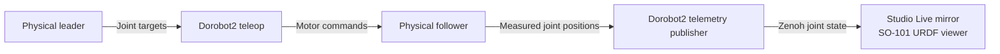
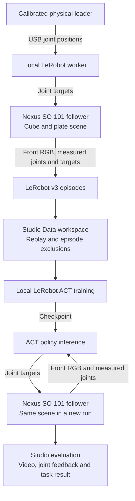
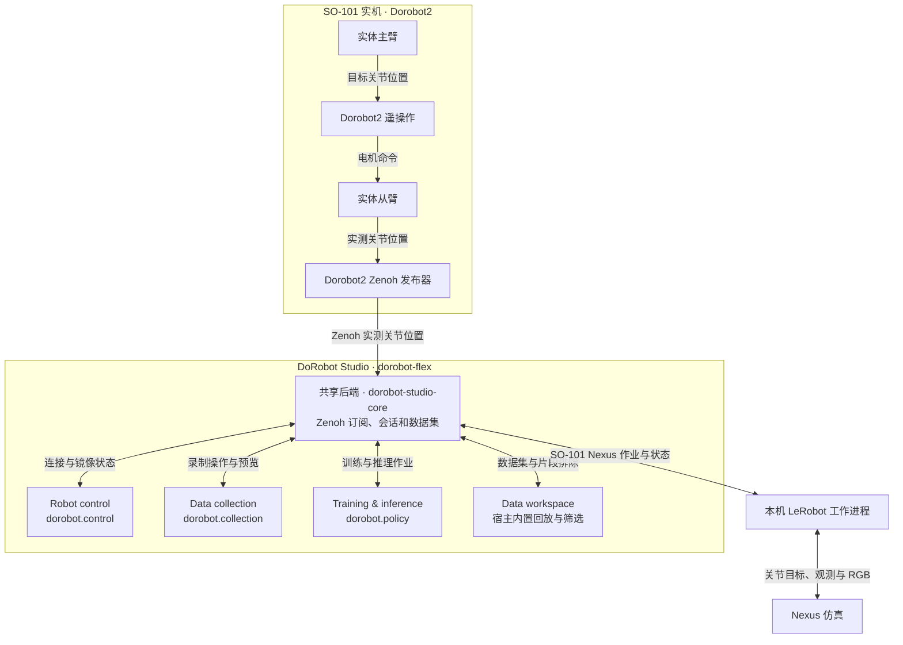

# DoRobot Studio

Adora Nano simulation, SO-100/SO-101 LeRobot data collection and dataset review
with the **Makepad** UI framework.

**AISLE Studio** · [Nano and G1 simulation workbench, requirements, UX and verification](docs/product/aisle-studio/README.md)

**SO-101 on Linux:** [live follower mirror](#physical-teleop-and-live-follower-mirror) ·
[Nexus collection, training and inference](#leader-driven-nexus-collection-training-and-inference)

**插件开发：[插件开发指南](docs/PLUGINS.md)** · [Rust 插件架构](#rust-插件架构)

**Start here: [Detailed user guide](docs/USER_GUIDE.md)** — installation, first
simulation, controller mappings, camera layouts, recording/replay, real hardware
calibration, Hub transfers and troubleshooting.

Current source builds include a compact **EN / CN** button at the bottom of the
sidebar. It shows the current language; click to switch **English / 简体中文**.
It remembers your choice without stopping
recording or playback. See [language support](docs/I18N.md).

The standalone Nano RC uses Rust for Studio, native Dora nodes, Nexus
simulation, controller/serial control, three-camera recording and dataset
transfer. Its bundle uses native FFmpeg for video. The SO-101 Nexus development
workflow uses an external LeRobot Python environment for collection and policy
jobs. See the [native runtime](runtime/README.md) and
[macOS release guide](tools/release/README.md).

For the current capture workflow, build requirements, verification results and remaining hardware checks, see [the functional review and setup guide](docs/FUNCTIONAL_REVIEW.md). Production mode is the default; use `--demo` for generated fixtures.

This is a standalone Git repository and Cargo workspace. Open this directory
as the project root. The application builds without a sibling Nexus checkout;
its shared UI crate is included in `crates/dorobot-ux`.

### iOS appearance and Makepad JIT

The desktop app uses OctoSense's current Makepad iOS light/dark style sheets,
with blue accents, grouped surfaces and rounded controls. Start it through the
Relax Rust JIT:

```sh
./tools/run_jit.sh
./tools/run_jit.sh --check
./tools/run_jit.sh --dark
```

The first launch builds a pinned runner in your user cache; later launches
reuse it. Rust, Cargo, Git, Python 3 and a platform C compiler are required.
The default JIT launch omits FFmpeg. With FFmpeg installed, use
`./tools/run_jit.sh --video` for video decoding. See [JIT setup and validation](docs/JIT.md)
for runtime versions, source editing and tested limits.

### Adora Nano preview

Nano's Feetech mobile base is also a supported robot in **Robot control → Robot setup → Real robot → Adora Nano**. It has a simulated-bus test mode and an explicit USB connection
for PS4/PS5 control through Dora. See the [driver guide](robots/adora_nano_feetech/README.md)
for setup, supported capabilities and validation. This driver covers the base;
arm and camera hardware drivers are not included in the supplied package.

The Nano URDF and meshes are included in `data/adora_nano`. From this project:

```sh
./tools/run_nano_preview.sh
```

The JIT launcher creates three synthetic joint-motion clips if needed and opens
them in the Play screen. Space plays/pauses; Home returns to the start. These
clips are kinematic previews, not captured data or commands for hardware.
This launcher builds without FFmpeg/video decoding; the standard build below
includes video playback. Model provenance and limits are recorded alongside
the assets.

### Live streaming

For the built-in scene, choose **Robot control → Robot setup → Simulation → Start simulation**.
Studio opens **Operate** when physics and all three cameras are ready. Use
**Record → Stop → Save → Replay** to capture and review a take.

For an existing external Dora source, choose **Robot control → Robot setup → More → External
stream**, enter its local socket path, and click **Connect**. The three Nano cameras, robot
pose and joint signals share one sample clock. Studio displays the measured
preview rate, reports stale input, and reconnects automatically. Disconnecting
the viewer leaves the source recording running.

Operate and Replay retain separate panel layouts and the replay playhead. When a
source finishes, **Open recording** opens its finalized dataset in Replay.
The [native runtime guide](runtime/README.md) describes the built-in Dora producer.
The [Nano room integration guide](tools/aisle-validation/README.md#mobile-nano-in-a-living-room)
retains the original AISLE validation experiments. The recording workflow currently
captures at 5 Hz; the Live mode does not imply 30 fps throughput.

See the [scripted three-cube stream](tools/nano-three-cubes/README.md) for the historical demo using simulator state.

### AISLE 与 Nexus 验证

[Adora Nano／AISLE 验证指南](tools/aisle-validation/README.md)保留可复现的仿真、原始数据导出、LeRobot 转换及 Studio 回放／审阅验证流程。指南同时记录多相机与场景扩展、证据产物和适用范围；应用内的原生 Rust 运行时使用方式见 [运行时指南](runtime/README.md)。

## SO-101 workflows

### Physical teleop and live follower mirror



The operator moves the physical follower with the leader while Studio mirrors
the follower's measured motion in 3D. Dorobot2 owns both serial connections and
the motor commands. Studio applies named joint readbacks to the URDF viewer as
teleop runs. Use **Robot control → Live mirror** to see the virtual arm track the
physical follower.

**Status.** A 35-second powered teleop run on one Linux PC applied 945 measured
follower poses in Studio over Zenoh TCP loopback. The p95 time from capture to
pose application was 18.2 ms. Same-host peer discovery was verified with
synthetic telemetry. Linux-to-macOS LAN validation is pending.
[Setup and measurement details](docs/SO101_LIVE_MIRROR.md)

### Leader-driven Nexus collection, training and inference



Start in **Robot control → SO-101 Nexus** with a calibrated leader and your
local LeRobot environment. In **Data collection → Record**, reset the scene,
wait for confirmation, and record and save a take. The follower is simulated
for both collection and inference. Stop the capture session, then choose
**Robot control → SO-101 Nexus → Open saved episode**. Review the take in
**Data workspace** and select **Use for training**. **Training & inference**
runs ACT locally and loads the resulting checkpoint into a fresh Nexus run.

**Status.** The native Linux desktop workflow was verified with synthetic
leader input. It saved a 25-frame LeRobot v3 episode, trained and reloaded an
ACT checkpoint, and completed 200 closed-loop actions with a saved H.264 video.
Studio reported that the cube placement was incomplete. Desktop video replay
was also verified. A physical-leader run through this Studio workflow is pending.
[Build and workflow steps](docs/PLUGINS.md#so-101-nexus-采集训练和推理)

## Rust 插件架构

本版本注册 **3 个内置 Rust 插件**，分别负责机器人控制、数据采集、训练与推理。数据工作区由 Studio 宿主管理。宿主通过共享 SDK 挂载插件面板并分发事件。



Dorobot2 管理真机串口并驱动实体从臂。Studio 的共享后端订阅 Zenoh，**Robot control → Live mirror** 用实测关节位置更新 URDF 模型。采集和策略插件通过共享后端运行本机 Nexus 工作流。数据工作区可以将所选 LeRobot v3 数据集和片段排除设置交给训练作业。

- **插件 SDK**：`StudioPlugin` 描述插件并注册面板工厂；`PluginPanel` 管理实例、状态同步、事件和停用回调。插件与面板 ID、API 版本在注册时校验。
- **共享核心**：集中提供 `Backend`、Dora 会话、数据格式、回放、控件、主题及国际化。模型解析在后台执行，缓存最近使用的模型；控件更新和 GPU 操作在界面线程执行。
- **宿主组合入口**：`dorobot-flex/src/plugins.rs` 注册插件。侧栏分组和顶部标签从插件清单生成，新增普通面板无需修改旧的 `Screen` 枚举。

侧栏每个插件只显示一个名称，点击后在右侧顶部展开其子功能，并在本次会话中记住上次使用的标签：

| 侧栏入口 | 顶部标签 | 提供方 |
| --- | --- | --- |
| 机器人控制 | 机器人设置、操作、SO-101 Nexus、实时镜像 | `dorobot-plugin-control` |
| 数据采集 | 录制 | `dorobot-plugin-collection` |
| 训练与推理 | 训练、推理与评估 | `dorobot-plugin-policy` |
| 数据工作区 | 数据集、回放、评估 | 宿主内置模块 |

当前插件与宿主**一起编译、静态链接**，新增插件后需要重新构建；尚未提供动态库安装或热卸载。通用工作流工具栏、文件选择器和回放窗口仍由宿主管理。

**开始贡献：[插件开发指南](docs/PLUGINS.md)**，包含接口说明、目录约定、注册步骤、现有插件示例和测试命令。开发流程：

1. 在 `plugins/<name>/` 创建 Rust crate，依赖 `dorobot-studio-plugin`，按需使用 `dorobot-studio-core`。
2. 实现 `StudioPlugin` 和 `PluginPanel`，将 crate 加入工作区及宿主依赖，再在组合入口注册。
3. 为实例独立性、按钮路由和活动任务保护添加测试。

```sh
cargo test --locked -p dorobot-flex --no-default-features --test plugins
cargo run --locked -p dorobot-flex --no-default-features -- --demo
```

## Overview

Dorobot provides tools for visualizing robotics datasets, with a focus on **LeRobot** format datasets:

- **dorobot-flex/**：工作台宿主与插件组合入口。
- **plugins/**：机器人控制、数据采集、训练与推理插件。
- **crates/**：插件 SDK、共享核心、界面库和数据类型。
- **runtime/**：原生 Dora 节点、仿真、硬件控制与录制，使用独立 Cargo 工作区。

## dorobot-flex

The primary application for LeRobot dataset visualization featuring:

- **Multi-camera video playback** with synchronized scrubbing
- **Live Dora streaming** with connection controls, measured preview rate and automatic reconnection
- **3D robot visualization** from URDF models
- **Time series plots** for joint states and sensor data
- **Flexible panel layout** with drag rearrangement, resizing, maximize/restore and local layout recovery
- **Additional native Replay window** sharing the episode and transport, with its own layout
- **Episode browser** with hierarchical task grouping

### Panel Drag-and-Drop

Drag a panel title to rearrange its content. Drag a divider to resize the grid;
use the panel's expand button to maximize it, and Escape to restore the grid.
**Replay → Panels** reopens closed views, changes the arrangement, resets the
layout, or opens a separate native **Replay window**. Both windows share the
selected episode and playback; their panel layouts are independent. The **Speed**
control cycles through 0.25×, 0.5×, 1× and 2× in both windows and survives restart. Closing
the extra window preserves the main task. Layouts and navigation width are
saved locally. Hardware uses the same panel behavior and has **Restore panels**.

Replay provides 3D, the available camera views and tracking error, including
all three cameras in a captured Nano dataset.
Camera panels explain missing media. Record and Hardware keep their controls
visible with setup guidance; recording stays disabled until a profile exists.
See the [functional UX judge loop](docs/ux/functional-review.md) for the workflow
checks, score, and unverified hardware limits.

## Project Structure

```text
dorobot-studio/
├── Cargo.toml                           # 工作区与固定依赖
├── dorobot-flex/
│   ├── src/bin/dorobot-flex.rs           # 窗口、导航、事件分发
│   ├── src/plugins.rs                   # 插件组合入口
│   ├── src/lib.rs                       # 原有库接口的兼容导出
│   ├── resources/                       # 界面资源及翻译目录
│   └── tests/plugins.rs                 # 真实控件与插件集成测试
├── plugins/
│   ├── control/src/                     # 机器人设置、校准与操作
│   └── collection/src/                  # 采集、录制与片段审阅
├── crates/
│   ├── dorobot-studio-plugin/src/       # 插件契约、注册表与面板生命周期
│   ├── dorobot-studio-core/src/
│   │   ├── api/                        # 业务后端、设备与工作流
│   │   ├── data/                       # 数据格式及后台模型加载
│   │   ├── ui/                         # 回放等共享界面
│   │   └── widgets/                    # 相机、时间轴与图表控件
│   ├── dorobot-ux/                      # 共享视觉样式
│   ├── dorobot-types/                   # 共享数据类型
│   └── dorobot-dora-bridge/             # 旧版 Dora 桥接库
├── runtime/                            # 原生 Dora 运行时，独立工作区
├── data/                               # 机器人描述与网格资源
├── vendor/makepad-urdf-player/          # URDF 模型加载与渲染
├── docs/PLUGINS.md                      # 插件开发指南
└── tools/                              # 开发、验证与打包工具
```

## Quick Start

### Prerequisites

- A current stable Rust toolchain
- FFmpeg development libraries (for video decoding)

On macOS:
```bash
brew install ffmpeg
```

On Ubuntu:
```bash
sudo apt install libavcodec-dev libavformat-dev libavutil-dev libswscale-dev
```

### Build and Run

```bash
cd dorobot-studio
cargo run --release -p dorobot-flex
```

### Loading a Dataset

1. Open **Data workspace → Library → Open folder…**
2. Choose a LeRobot dataset directory (containing `meta/info.json`), or a parent library folder
3. Open a dataset and use **Episodes** to select an episode
4. Use playback controls or drag the timeline to scrub

### Keyboard Shortcuts

| Key | Action |
|-----|--------|
| Space | Play/Pause |
| Left/Right | Step frame |
| Home/End | Jump to start/end |

## LeRobot Dataset Format

dorobot-flex expects the standard LeRobot dataset structure:

```
dataset/
├── meta/
│   ├── info.json           # Dataset metadata (fps, robot_type, etc.)
│   ├── episodes.jsonl      # Episode index
│   └── tasks.jsonl         # Task descriptions (optional)
├── data/
│   └── chunk-000/
│       └── episode_000000.parquet  # Frame data
└── videos/
    └── chunk-000/
        ├── observation.images.cam_high/
        │   └── episode_000000.mp4
        └── observation.images.cam_low/
            └── episode_000000.mp4
```

## Dependencies

- **makepad-widgets**: GPU-accelerated UI framework
- **makepad-app-shell**: Flexible panel layout shell
- **makepad-urdf-player**: URDF model loader and renderer
- **ffmpeg-next**: Video decoding
- **parquet/arrow**: Data file parsing

## License

MIT
