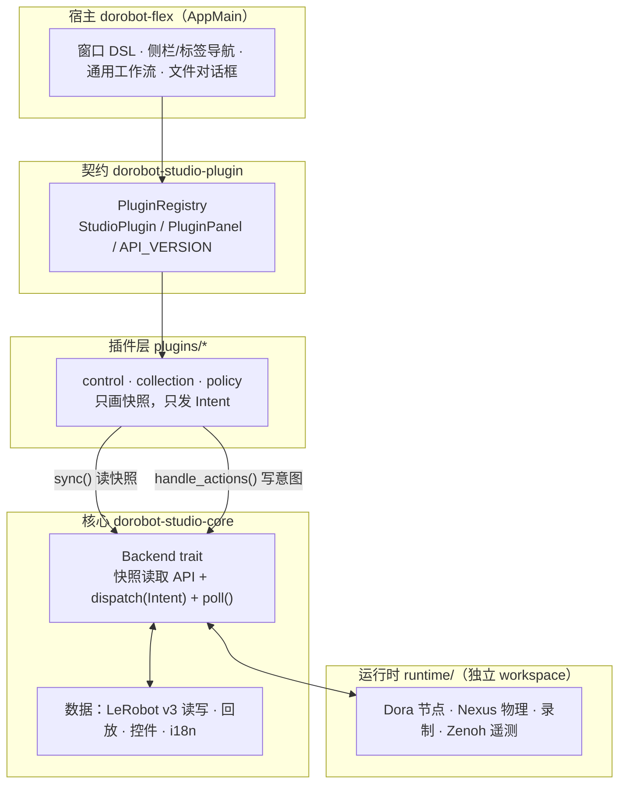
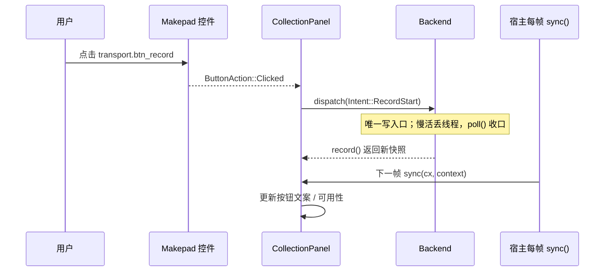

# DoRobot Studio 上手指南（7 天 · 每天 90 分钟）

> 写给"要在这个仓库里做出可合入改动"的人，不是写给"要把代码读完"的人。
> 基线：`main` @ `8ff8c32`（v0.1.0-rc.2 + 38 commits），89 个 Rust 文件、约 3.4 万行（不含 vendor 与 examples）、131 个 `#[test]`。
>
> **诚实声明**：撰写时没有在本机执行完整构建（仓库无 `target/`，首次构建需拉取固定 rev 的 Makepad，预计 10–20 分钟）。下文每条命令都标注了预期结果——请用它校验本文，而不是信任本文。

---

## 0. 先给判断

**三句话**

1. 这**不是**一个靠"读代码"就能懂的项目，而是一个**边界极其清晰**的项目。3.4 万行里，决定你能否上手的只有 3 个边界。
2. **杠杆在插件契约上**。宿主不声明界面，界面由插件工厂产出。会加插件 = 能无限扩展产品而不碰宿主——这是这个仓库里唯一接近"零边际成本"的能力。
3. **具体知识（specific knowledge）只有三样，且不可外包**：LeRobot 数据格式的细节、遥操作/遥测的时序、Makepad 的脾气。其余都可查。

**所以顺序是**：先建反馈回路 → 再攻边界 → 最后补知识。

反过来做（先通读 README、先系统学 Makepad DSL、先配硬件）是最慢的路。

**三个不要**

- 不要通读 3.4 万行。阅读顺序由"你要改什么"决定，不由文件树决定。
- 不要先学 Makepad DSL 全貌。你只需要会读**一个**面板的 DSL，以及 `ids!()` 路径怎么对应。
- 不要碰 `runtime/`。那是第二个 workspace、Vulkan/Nexus、真机串口——另一门专业，第 6 天再说。

---

## 1. 心智模型

### 1.1 一张图



### 1.2 一句话（背下来）

> **宿主负责壳和导航；插件只做两件事——把 Backend 的快照画出来，把点击翻译成 Intent。Intent 是唯一的写入口，Backend 是唯一的真相源。**

压缩成四个字：**快照向下，意图向上**。

如果只能记住一句，记这句。它能回答 80% 的"我该改哪"。

### 1.3 五层与"改这里"的信号

| 层 | 目录 | 职责 | 你什么时候碰 | 反馈成本 |
| --- | --- | --- | --- | --- |
| 宿主 | `dorobot-flex/` | 窗口、导航、通用工作流、文件对话框、事件循环 | 改壳、加导航 | 高（要编整个 bin 并跑起来看） |
| 契约 | `crates/dorobot-studio-plugin/` | 注册表、生命周期、版本校验 | 几乎不碰（改 SDK 要动所有插件） | 中 |
| 插件 | `plugins/*` | 面板界面 + 意图映射 | **90% 的界面需求** | 低（一个 `--test plugins` 就够） |
| 核心 | `crates/dorobot-studio-core/` | Backend、数据格式、回放、共享控件 | 改行为、加数据能力 | 中 |
| 运行时 | `runtime/` | 仿真、硬件、采集管线 | 改机器人/采集 | 很高（独立 workspace） |

### 1.4 一次点击的完整生命周期（全项目最重要的 40 行）



对照代码：

1. DSL 按钮路径：`transport.btn_record`（`plugins/collection/src/screen.rs`）
2. 意图映射：`plugins/collection/src/lib.rs:153-159`
3. 写入口：`Backend::dispatch`（`crates/dorobot-studio-core/src/api/mod.rs:566`）
4. 状态变化：`RecordState` 字段
5. 快照回读：`plugins/collection/src/lib.rs` 的 `sync()`
6. 宿主驱动：`App::sync_plugins` → `PluginRegistry::sync`（只 sync 当前可见面板）
7. 离开面板：`on_disable`，**实例保留**，下次进入复用

---

## 2. 20/80 阅读清单

按顺序读，总计约 2000 行 ≈ 全仓库 5.9%。**第一周的全部阅读量就这么多。**

| # | 文件 | 行数 | 为什么读 | 读完必须能答 |
| --- | --- | --- | --- | --- |
| 1 | `crates/dorobot-studio-core/src/api/mod.rs` | 570 | 整个领域语言：6 个 State 结构 + `Intent` 全部变体 + `Backend` trait | 有哪 6 个界面？为什么 `dispatch` 必须"cheap and non-blocking"？ |
| 2 | `crates/dorobot-studio-plugin/src/lib.rs` | 482 | 生命周期与注册校验（重复 ID、API 版本、`legacy_screen` 冲突） | 为什么 `create` 调两次必须得到两个**不同** `widget_uid`？ |
| 3 | `dorobot-flex/src/plugins.rs` | 15 | 组合根，全部接线就这 15 行 | 加一个插件要改几处？（答：crate + Cargo + 这 15 行） |
| 4 | `plugins/collection/src/lib.rs` | 187 | 最小完整切片：描述 / 创建 / sync / actions / can_disable | 为什么录制中 `can_disable` 必须返回 `Err`？ |
| 5 | `dorobot-flex/tests/plugins.rs` | 633 | 可执行规格，比文档可信 | 哪个测试保证了"新增面板不用改 `Screen`"？ |
| 6 | `dorobot-flex/src/bin/dorobot-flex.rs:1671-1776` | 105 | `AppMain` 事件循环、`LiveEdit` 重挂载 | 热重载时宿主做了什么？ |

**读法**：每个文件读完立刻合上，用一句话写"它负责什么、不负责什么、谁会调用它"。写不出来就是没读懂，回去只读结构（`pub fn` / `pub trait` / `enum`），不要读函数体。

---

## 3. 概念卡（6 张，每张 30 秒）

| 概念 | 定义 | 位置 | 常见误解 |
| --- | --- | --- | --- |
| **Backend** | 拉状态（`library()` / `hardware()` / `record()` / `playback()` / `eval()`）+ 推意图（`dispatch`）+ 每帧 `poll()` | `core/src/api/mod.rs:540` | 当成"服务层"直接在里面开设备。慢活必须丢线程，结果从下一帧快照进来 |
| **Intent** | 每一条 UI 变更请求的枚举，全部可审计、可脚本化、可测试 | `core/src/api/mod.rs:474` | 面板自己存业务状态。面板只该存**界面**状态 |
| **Panel 生命周期** | `root()` → `sync()`（可见才调）→ `handle_actions()`（可见才调）→ `on_disable()`（离开时） | `plugin/src/lib.rs:41` | 以为 `sync` 对全部面板每帧调用 |
| **插件实例** | 描述是 `Copy` 的静态数据；状态在实例里；工厂可创建多个独立实例 | `plugin/src/lib.rs:32` | 把状态塞进 `PluginDescriptor` |
| **`Screen`** | 遗留兼容层，通过 `legacy_screen` 与面板映射 | `core/src/api/mod.rs:440` | 以为加界面要加枚举变体。**新面板用 `legacy_screen: None`** |
| **双 workspace** | 根（Makepad/JIT/ffmpeg 8.0/edition 2021）vs `runtime/`（edition 2024、Vulkan、自有 vendor） | 两个 `Cargo.toml` | 在根目录 `cargo test` 以为测了 runtime |

---

## 4. 刻意练习：怎么用在这个仓库

### 4.1 目标表现（可证伪，不是"理解"）

30 天内做到，任何一条做不到就说明练偏了：

- **P1** 15 分钟内回答"点 X 会改哪几个文件"。
- **P2** 不查文档，给 collection 插件加一个只读面板，并通过 registry 全树测试。
- **P3** 加一个 Intent 端到端（UI → mock → 测试），CI 绿。
- **P4** 用仓库自带的 rubric 给自己的改动打分，并说明扣分项。

### 4.2 技能分解（每项都有判定标准）

| 子技能 | 判定标准 | 练法 |
| --- | --- | --- |
| 读结构 | 5 分钟说出一个 crate 的职责边界 | 只读 `pub` 签名，跳过函数体 |
| 追链路 | 一条点击能写出 7 步，含文件名与函数名 | 第 2 天的 drill，闭卷默写 |
| 加面板 | 只改 1 个插件 + 1 个测试就挂上新 tab | 第 3 天 |
| 加意图 | 4 个文件（mod/mock/files/screen）改完 CI 绿 | 第 4 天 |
| 读数据 | 能指出 v3 单文件多 episode 的 offset 在哪处理 | 第 5 天 |
| 观感判断 | 用 `tools/ux/*rubric.json` 给出分数与理由 | 第 7 天 |

### 4.3 五个反馈回路（永远用能证伪假设的**最便宜**那个）

| 级别 | 命令 | 延迟 | 能证伪什么 |
| --- | --- | --- | --- |
| L0 类型 | `cargo check --locked -p <crate>` | 增量 5–30s | 类型、借用、特性组合 |
| L1 契约 | `cargo test --locked -p dorobot-studio-plugin` | ~1 分钟 | 注册表规则、生命周期、API 版本 |
| L2 界面行为 | `cargo test --locked -p dorobot-flex --no-default-features --test plugins` | ~2 分钟 | **真实控件**的路由、可见性、脚本错误（不开窗口） |
| L3 观感 | `./tools/run_jit.sh`（DSL 热重载） | 秒级重载 | 布局、配色、文案、交互手感 |
| L4 全量 | `cargo test --locked --workspace --no-default-features` | 数分钟（CI 30 分钟超时） | 跨 crate 回归 |

**纪律**：L0 的问题不要用 L4 调；L2 能测出来的行为不要靠肉眼；L3 只用来判断"看起来对不对"。用错回路是新手上手期最大的时间漏洞。

### 4.4 难度阶梯（每次只加一个变量）

```
读一个切片 → 改文案/可见性 → 加面板 → 加 Intent → 改数据 → 改运行时
```

每一级都**先写一个会失败的测试**。这不是我的偏好——仓库自己的计划文档就是这么写的（`docs/superpowers/plans/2026-11-17-rust-plugin-workbench.md`：*"先写注册冲突、工厂实例和生命周期测试，记录失败，再实现 SDK"*）。照做，review 的人会认。

---

## 5. 七天日程

### Day 0 · 环境与基线（45 min，可与 Day 1 合并）

```sh
rustc --version                     # 本机 1.98.0；CI 用 1.95.0，别用太新的语法
cargo check --locked -p dorobot-studio-plugin   # 首次会拉 Makepad git rev，5–15 min
cargo test  --locked -p dorobot-studio-plugin   # 预期：registry 测试全绿
```

**验收**：能说出"为什么这个 crate 不需要 FFmpeg 也能编"（答：它对 core 用了 `default-features = false`，`video` 特性关掉了 `ffmpeg-next`）。

**卡住**：网络拉不下 git 依赖 → `cargo fetch` 重试或先配代理；不要为了绕过它去改 `Cargo.toml` 的 rev。

### Day 1 · 跑起来 + 画图（90 min）

```sh
cargo run --locked -p dorobot-flex --no-default-features -- --demo
```

（无视频特性，不需要 FFmpeg。默认构建才需要 `libav*`。）

**做**：把 3 个插件入口、7 个面板、Data workspace 的 3 个 tab 全点一遍；然后**合上电脑，凭记忆画一张图**：插件 → 面板 → 落到哪个 `Screen`。

**验收**：图能覆盖 `control`(4 面板) / `collection`(1) / `policy`(2) = 7 个面板 + Data workspace 的 3 个 tab(Library/Play/Eval)，并标出哪些面板的 `legacy_screen = None`（答：`nexus_setup`、`hardware_live_mirror`、`nexus_train`、`nexus_rollout`，共 4 个；其余 3 个仍映射到 `Screen`）。

**这一步的意义**：把文字变成空间结构。图错了不要紧，错的地方就是你的知识缺口。

### Day 2 · 追一条点击链路（90 min）

**做**：不看本文，从 `transport.btn_record` 开始，找到：控件 → panel → Intent 变体 → `Backend` 实现（`MockBackend` 与 `FileBackend` 各在哪）→ 快照 → `sync()`。写出 7 步，标注文件名与行号。

然后跑一个真实控件测试，看"路由"是怎么被断言的：

```sh
cargo test --locked -p dorobot-flex --no-default-features --test plugins collection_factory -- --nocapture
```

**验收**：闭卷复述这 7 步；能解释测试里 `cx.capture_actions(...)` + `ButtonAction::Clicked` 为什么能替代真实鼠标。

### Day 3 · 第二个闭环：加一个只读面板（120 min）

**只改 1 个插件，不改宿主，不改 `Screen`。**

1. `plugins/collection/src/lib.rs` 的 `descriptor().panels` 加第二项：`id: "collection_notes"`、`title: "Notes"`、`legacy_screen: None`。
2. `create()` 加分支：`script_eval!` 一个 `View{ Label{...} }`（照抄 `nexus_setup` 的写法）。
3. 跑 L2：`cargo test --locked -p dorobot-flex --no-default-features --test plugins`。

**验收**：`--demo` 里侧栏**仍然只有一个**"数据采集"入口（有测试守着：`toolbox_has_one_entry_per_plugin_instead_of_one_per_panel`），但点进去顶部多一个 tab；切走再切回会停在最后用的 tab（`recent_panels`）。

**你会学到**：描述驱动 UI、tab 自动生成、`legacy_screen` 的真实含义。

### Day 4 · 加一个 Intent，端到端（120 min）

练 `Intent::TagAllEpisodes(Tag)`：UI 一个按钮 → 全部 episode 打标。

四个文件：`api/mod.rs`（枚举变体）→ `api/mock.rs`（实现）→ `api/files.rs`（真实实现，复用已有打标逻辑）→ 插件面板（按钮 + 映射）+ 一个测试。

**验收**：测试断言 dispatch 后 `playback().episodes` 全部带 tag；`cargo test --workspace --no-default-features` 绿。

**这是全仓库性价比最高的一次练习**：它同时穿过 UI 层、契约层、业务层、数据层——做完这一遍，架构图就长在你脑子里了。

### Day 5 · 数据面（90 min）

1. 打开一个 LeRobot 目录（`--dataset <dir>`）：`meta/info.json`、`meta/episodes.jsonl`、`data/**/*.parquet`、`videos/**/*.mp4`。
2. 读 `core/src/data/lerobot_dataset.rs`，找三件事：`info.json` 怎么变成 `DatasetSummary`；`observation.state` / `action` 怎么变成 `PlotChannel`；v3 单文件多 episode 的 `video_frame_offset` 在哪算。
3. 回答：`EpisodeStats::drift_frames` 非零意味着什么？（视频与 parquet 对"何时发生"不一致）

**验收**：画出 `目录 → DatasetSummary → PlaybackState → 三个 panel` 的数据流，能指出每一跳的文件。

### Day 6 · 选一条支线（120 min）

见第 6 节。只选一条，不要并行。

### Day 7 · 输出（90 min）

写一页 `docs/notes/<date>-onboarding.md`：架构图 + 3 个坑 + 1 个 PR 链接，开 PR。

**为什么必须输出**：公开承诺是最便宜的强制反馈机制。写不出来的部分，就是你还没真正懂的部分。

---

## 6. 三条支线（第 6 天之后）

| 支线 | 前置 | 必读 | 第一个任务 | 风险 |
| --- | --- | --- | --- | --- |
| **A 界面 / 插件**（最快出成果） | 无 | `docs/PLUGINS.md` + `plugins/*/src/screen.rs` | 一个只读面板（如 Dataset inspector：fps/frames/drift） | 低。测试覆盖好，反馈快 |
| **B 数据 / ML** | 会用 Python + LeRobot | `api/nexus.rs`、`tools/nexus_workflow/`、`data/lerobot_writer.rs` | 用合成 leader 输入跑一遍采集→训练→推理 | 中。需要 Linux + LeRobot venv；ACT 训练吃 GPU |
| **C 硬件 / 运行时** | Linux + Rust 底层经验 | `runtime/README.md`、`docs/SO101_LIVE_MIRROR.md` | 跑通 `dorobot-so101-session` 的仿真模式 | 高。Vulkan、串口、真机安全 |

---

## 7. 陷阱清单（本仓库专属）

1. **首次构建贵**：无 `target/`，Makepad 走 git rev。别用 `cargo build` 全量验证，先 `cargo check -p`。
2. **两个 workspace**：根目录的 `cargo test` **不测** `runtime/`。runtime 有自己的 `Cargo.lock` 与 edition 2024。
3. **不要升级依赖**：Makepad 固定在 `44d8220f`，`ffmpeg-next =8.0.0`，且有 `[patch.crates-io] bitflags` 绑在同一个 rev 上。升一个，全盘崩。
4. **Makepad DSL ≠ Rust**：`script_mod!` 里的 `ids!()` 路径必须与 DSL 树逐字一致；拼错只在运行时/测试里以 "script error" 出现。护栏是 `every_builtin_factory_and_toolbox_has_no_script_errors`。
5. **`Screen` 是遗留层**：新面板用 `legacy_screen: None`。加枚举变体会撞上 `plugin_panel_named_play_cannot_shadow_the_hosts_replay_tab` 这类测试。
6. **`dispatch` 不许阻塞**：慢活丢线程，结果从下一帧快照回来。在 `dispatch` 里 `sleep`/`join` 会让整个 UI 卡住。
7. **插件不持有业务**：不复制设备驱动、不复制会话管理。状态放实例，业务走 `Backend`。
8. **文案要进 i18n**：UI 字符串会被 `Localizer` 覆盖，新增文案要进 `dorobot-flex/resources/i18n/zh-CN.json`，否则切中文缺词。
9. **插件是编译时链接**：`cargo run` 路线改插件必须重编。`run_jit.sh` 走 Relax，源码编辑被监听、**支持的改动**会补丁进运行中的进程；改动正在运行的长函数时 runner 会提示重启——热重载没生效先重启，别先怀疑代码。
10. **Rust 版本差**：本机 1.98 / CI 1.95。新语法可能本地过、CI 挂。保守写。
11. **不要 `git submodule update --recursive`**：`examples/rerun-*` 指向整个 rerun 仓库，很大，且默认构建不需要。
12. **硬件测试一条都不碰真机**：`cargo test` 全程不打开硬件；SO-101/Nexus 需要 Linux Vulkan + 本地 LeRobot venv。

---

## 8. 间隔重复：10 道自测题

第 **1 / 2 / 4 / 7 / 15** 天各花 5 分钟，闭卷回答：

1. 点一下 Record，从控件到 UI 刷新经过哪 4 个函数？
2. 为什么 `Intent` 必须是唯一写入口？面板直接改后端会坏在哪？
3. 为什么 `Backend::dispatch` 不能阻塞？
4. 新加一个面板要不要改 `Screen` 枚举？为什么？
5. `legacy_screen: None` 意味着什么？谁决定这个面板何时显示？
6. `sync()` 与 `handle_actions()` 的职责边界？
7. 根 workspace 与 `runtime/` 为什么要分开？
8. 一个 LeRobot 数据集目录里，meta / 帧数据 / 视频分别在哪？
9. 为什么插件被禁止持有设备驱动或会话管理？
10. 要改"保存中禁用按钮"的逻辑，最可能改哪两个文件？

答不出第 1、4、6 题 → 回 Day 2；答不出第 8 题 → 回 Day 5。

---

## 9. 第一个 PR 菜单（按风险从低到高）

| # | 任务 | 触点 | 验收 |
| --- | --- | --- | --- |
| 1 | 补一条 `visible_in` 断言（外部流断开时 Operate 面板隐藏） | `dorobot-flex/tests/plugins.rs` | 参考 `disconnected_operate_panel_respects_the_hosts_setup_gate`；CI 绿 |
| 2 | 新增文案 + 翻译 + 截图 | 插件 `screen.rs` + `zh-CN.json` | `tools/ux/capture_matrix.py` 出图；中英切换不缺词 |
| 3 | 只读面板（Dataset inspector） | `plugins/*` 单文件 + 测试 | 侧栏不新增入口；tab 自动出现 |
| 4 | `Intent::TagAllEpisodes` 端到端 | `api/mod.rs` `mock.rs` `files.rs` + 面板 + 测试 | 全量测试绿 |
| 5 | 按 rubric 修一个扣分项 | `docs/ux/functional-review.md` 的 Remaining deductions | 用同一把尺子复验并附截图 |

---

## 10. 附录

### 命令速查

```sh
# 无视频、最快跑起来
cargo run --locked -p dorobot-flex --no-default-features -- --demo

# 带视频（需 FFmpeg 开发库）
cargo run --release -p dorobot-flex

# JIT + DSL 热重载（首次建 runner 到用户缓存）
./tools/run_jit.sh            # 可选 --check / --dark / --video

# 分层测试
cargo test --locked -p dorobot-studio-plugin
cargo test --locked -p dorobot-flex --no-default-features --test plugins
cargo test --locked --workspace --no-default-features     # CI 同款

# 运行时（独立 workspace）
cargo build --manifest-path runtime/Cargo.toml --release --locked --bin dorobot-so101-session
```

### 术语表

| 术语 | 含义 |
| --- | --- |
| rig | 设备配置：robot_type / follower / leader / cameras / task / destination |
| teleop | 遥操作，主臂（leader）带动从臂（follower） |
| URDF | 机器人描述格式，3D 视图与关节角映射的来源 |
| Dora | 数据流图运行时，节点间传数据 |
| Zenoh | 低延迟 pub/sub，实测关节位置的传输层 |
| LeRobot v3 | 数据集格式：`meta/` + parquet 帧 + 分块 mp4 |
| ACT | 模仿学习策略，本仓库的训练/推理对象 |
| Nexus | 物理仿真（Vulkan），SO-101 的仿真从臂 |
| JIT | Makepad 的脚本热重载运行器 |
| snapshot / intent | 快照（向下读）/ 意图（向上写），本项目的核心二分 |

---

## 11. 自检：这份文档不是静态的

```sh
python3 tools/onboarding_check.py -v
```

22 条 **OC 检查**把本文依赖的事实钉在代码上：workspace 成员、插件与面板清单、`legacy_screen = None` 的集合、`Backend` 的写方法、依赖锁定、CI 版本、引用路径，以及**本文自己的行数与规模数字**。

任何一条 FAIL 只有两种可能——代码变了（更新本文），或本文写错了（修本文）。不接受"检查太严"这种解释。

```text
OC-01…OC-05  结构：workspace / 插件 / 面板 / legacy / Screen
OC-06…OC-12  契约：Backend / PluginPanel / sync 门控 / 依赖 / 双 workspace / CI
OC-13…OC-17  规模与护栏：文件、行、测试、路径、i18n、--demo
OC-18…OC-22  本文自身是否过期
```

建议在改完插件或面板后跑一次；也可以挂进 pre-commit。
