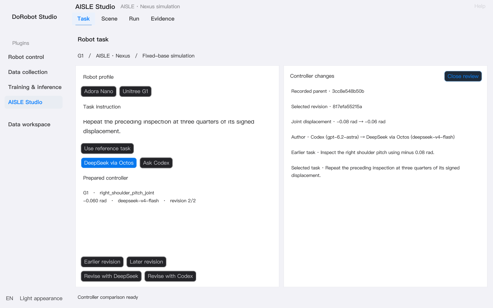
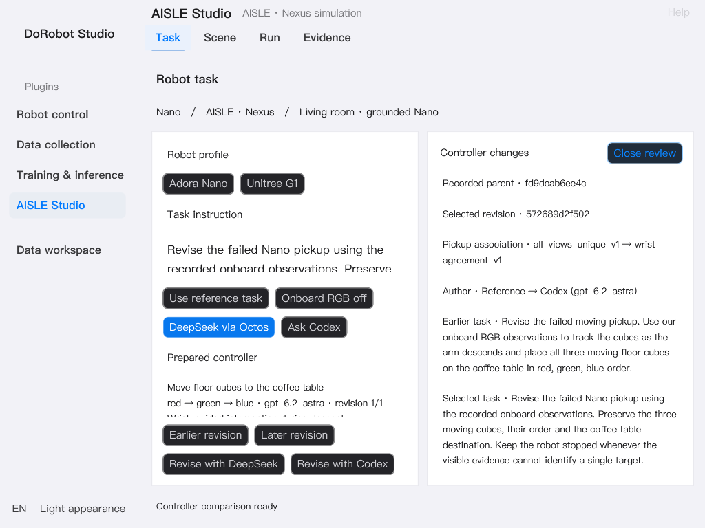

# Review a controller revision

On **Task**, select Nano or G1 and use **Earlier revision** or **Later revision** to select a saved program. Choose **Review changes** next to the robot preview. The panel shows both controller digests, the settings added, removed or changed, the author and model, and any change to the task instruction. **Close review** returns to the preview and keeps the same runnable revision selected.

**Recorded parent** means Studio found the exact controller named by the revision's SHA-256 in a saved preparation, trained program or trial. For a trained checkpoint, the teacher is its immediate parent. **Earlier saved revision** compares an independently prepared program with its preceding saved revision for that robot. If a named parent is missing, the status line identifies its digest. Restore the original controller in the workspace and reopen the review. If the selected file itself changed, select the intended revision again. Each completed comparison retains both full digests and the structured field changes in its job's `comparison.json`.

## G1 author handoff

Codex prepared a right shoulder pitch inspection at −0.08 rad. DeepSeek through Octos received its measured outcome and a request for three quarters of the signed displacement. Task showed **−0.08 rad → −0.06 rad**. In the fixed-base Nexus simulation, the joint moved −0.079959 and −0.059967 rad respectively. After a Studio restart the comparison showed the same parent, selected program and change.



## Nano pickup revision

A three-cube trial stopped during the blue pickup. Its Codex-authored revision changed the association method from `all-views-unique-v1` to `wrist-agreement-v1`. The parent came from the recorded trial, while the revised controller was the only prepared revision on Task. The comparison used the controller retained in the failed trial. Studio then ran the revised program with the original authoring packet. All three cubes reached the table and the 1,179-frame trial reopened after restart. This is one previously disclosed simulation layout.



A 1024 × 768 headless journey separately compared independent inspection programs for both robots. Another headless session opened a G1 revision alongside an unrelated older program. The missing-parent message identified the expected digest. Restoring the parent bytes allowed comparison on the next click. Changing the selected file after selection produced an error, and the selected in-memory program stayed intact.

Run `python audit.py --rerun-worker` from this directory to check the digests, field changes, recorded trajectories, Nano motor journals, and restored G1 comparison. The regular native verifier exercises this control in its `--handoff`, `--revision-selection` and `--revise-pickup` journeys. [Native receipts and measured trials](trials.zip) · [Results](results.json) · [Missing-parent test](check_unavailable.py)


To repeat the missing-parent and modified-file UI checks from the archived programs, use the same Studio executable and Makepad remote binary as the native verifier. With `DOROBOT_AISLE_PYTHON` set to the workbench Python, run this from the evidence directory.

```sh
work=$(mktemp -d)
unzip -p trials.zip g1-handoff-changes/before/controller.json > "$work/parent.json"
unzip -p trials.zip g1-handoff-changes/after/controller.json > "$work/revision.json"
unzip -p trials.zip G1-earlier-changes/after/controller.json > "$work/other.json"
python check_unavailable.py --studio "$STUDIO_BIN" --remote "$MAKEPAD_REMOTE" \
  --parent "$work/parent.json" --revision "$work/revision.json" \
  --unrelated "$work/other.json" --out "$work/verification"
```

The resulting `verification/checks.json` corresponds to `unavailable.json` in the archive. Native `--handoff` recovery writes `g1-restored-changes.json`, retained in the archive as `restored-g1.json`.


The [archive builder](archive.py) takes the completed `--handoff`, `--revision-selection` and `--revise-pickup` verification output directories plus the output of the missing-parent check. Use `python archive.py --help` for the argument names.
