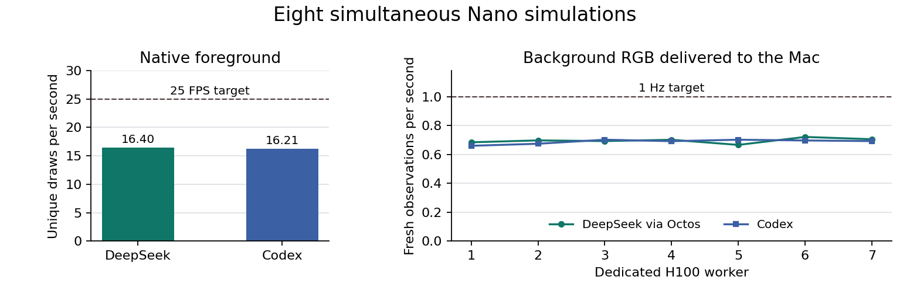

# Eight Nano simulations on eight H100s

The Mac runs DoRobot Studio and asks a provider to prepare one controller per session. A Linux server runs eight independent AISLE/Nexus simulations, one per NVIDIA H100 NVL. GPU 0 streams the Nano head camera to the native Makepad viewport while recording all three onboard RGB cameras. GPUs 1–7 publish a head-camera observation every 100 physics ticks. Each Nano uses RGB and encoders to transfer the red floor cube to the coffee table in the same living room.

## Measured capacity

| Author | Eight-way overlap | Source camera | Native viewport | Seven background feeds | Nano tasks passed |
| --- | ---: | ---: | ---: | ---: | ---: |
| DeepSeek via Octos | 90.74 s | 18.18 FPS | 16.40 FPS | 0.67–0.72 Hz | 8/8 |
| Codex | 90.65 s | 17.75 FPS | 16.21 FPS | 0.66–0.70 Hz | 8/8 |

Eight simultaneous sessions completed with both providers. The 25 FPS foreground and 1 Hz per background targets both remain open on this configuration. The remote source camera itself produced fewer than 25 unique frames per second, so improving transport alone cannot meet the foreground target. Each task ran for 6,948 physics ticks with continuous measured wheel support, and red settled on the coffee table. Both foreground datasets reopened after Studio restarted. The two exports each contain 347 synchronized frames per camera, action and encoder data, and calibration. FFprobe decoded all 347 frames from each of the six exported 480 × 360 videos.

Each provider received eight independent requests with up to three preparations in flight. DeepSeek via Octos used deepseek-v4-flash and took 8.88 s to prepare eight programs, Codex used gpt-6.2-astra and took 19.06 s to prepare eight programs. The model choice changed authoring latency. Each provider ran one cohort. The small difference in simulation speed is within the variation these two measurements leave unresolved.

On the previously tested 128 GiB M3 Max, six local sessions met both cadence targets with both providers. The Mac used the earlier controller and local transport. The eight-H100 run used the revised controller and remote workers over SSH. The measurements describe those two configurations. [Mac measurements, configurations and failed higher loads](../foreground-preview/README.md)

[Machine-readable results](measurements.json) · [Raw draws, worker observations, model receipts, motor journals and both complete LeRobot exports](measurements.zip). Archive SHA-256 `2a9f0abc7357f122f1a2e7790462027d2733b6b32aa9ac4b70e84a661fadf890`.

## Workload and measurement

The eight controllers in each cohort came from eight real authoring requests. Each author received the exact same measured contact-loss feedback and an explicit 80 mm/s forward limit. The local controller runs throughout navigation, grasp and placement. The provider is called during preparation. These cohorts measure the Studio workflow and its infrastructure on one fixed task and scene. Testing generalization uses the separate paired layout study. [Wheel-contact revision and held-out outcomes](../nano-forward-speed/README.md)

The viewer is a 1440 × 900 native offscreen Makepad window. Each draw counts only when a new simulation tick reaches the viewport. A Mac observer records each background frame's receive time and verifies the complete 480 × 360 RGB plane against its checksum in the original worker archive. The common window starts after every background has reported a positive physics step and ends at the earliest final advancing worker sample. Rate calculations use the first and last distinct delivery inside that window. The audit also reports the count divided by the full window. It uses the Mac monotonic clock to find overlap and the native draw clock for frame-to-frame intervals. The remote capture clock is used only for durations between remote captures. [Protocol declared before dispatch](protocol.md)

## Reproduce

Start with the native Studio binary, Makepad remote instrument, a configured Codex or Octos author on the Mac, and an installed Linux worker checkout with the Nano model, AISLE, Nexus 0.2.1, NVIDIA Vulkan ICD and the Mesa device-selection layer. The node registry contains private SSH paths and remains on the local machine. The setup creates eight fresh worker spools under an existing remote directory. [Install Studio](../../README.md) · [Set up a Linux worker and SSH transport](../remote-nano/README.md)

~~~sh
guide=docs/product/aisle-studio/validation/eight-h100
python3 "$guide/configure.py" --ssh "$worker_host" --ssh-config "$worker_ssh_config" \
  --checkout "$remote_studio" --aisle-root "$remote_aisle" \
  --interpreter "$remote_nexus_python" --remote-parent "$remote_spool_parent" \
  --out "$nodes_file"
~~~

For each provider, set `cohort` to a fresh output directory, `provider` to `codex` or `octos-deepseek`, and `failed_trial` to the original scored Nano trial with the two wheel-support gaps. Use the Studio Python environment. Finish one measurement before starting the next foreground stream.

~~~sh
"$DOROBOT_AISLE_PYTHON" "$guide/prepare.py" --provider "$provider" \
  --feedback "$failed_trial" --out "$cohort/authors"
"$DOROBOT_AISLE_PYTHON" "$guide/run.py" --nodes "$nodes_file" \
  --studio "$studio_binary" --remote "$makepad_remote" \
  --authors "$cohort/authors" --out "$cohort/measurement"
~~~

Run the public archive audit with Python's standard library.

~~~sh
python3 "$guide/audit.py" "$guide/measurements.zip"
~~~
