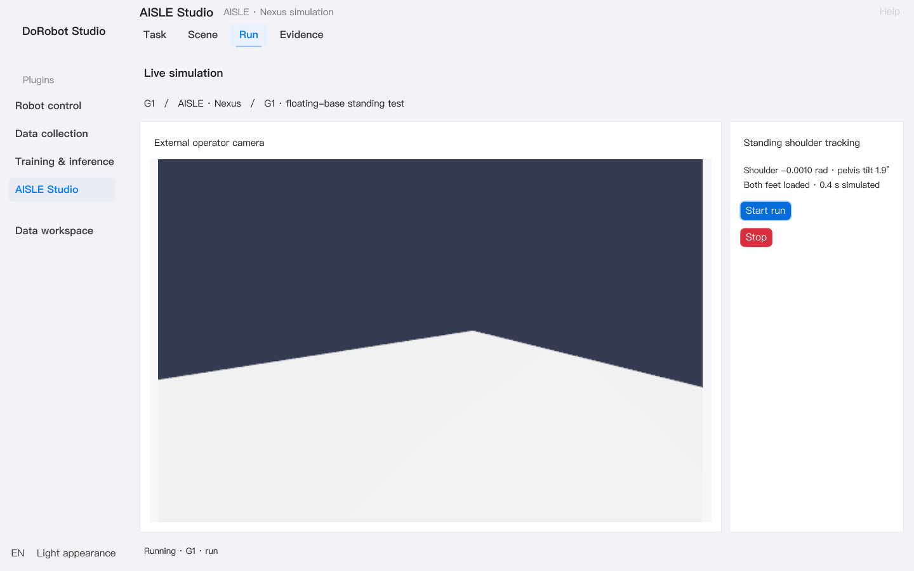

# Track a shoulder target on a standing G1

In **AISLE Studio → Task**, select **Unitree G1**. Enter “Stand on both feet and track a right shoulder displacement of minus 0.08 rad for the standing test.” Choose **DeepSeek via Octos**. Scene identifies the free pelvis and gravity. Run displays an external operator camera, shoulder angle, pelvis tilt and foot support. Evidence shows the endpoint and support over the ten-second development trial.

The AISLE Nexus adapter loads the repository's 29-joint URDF with a floating root and gravity. The local controller uses body attitude as a simulated IMU, pitch-rate feedback at the ankles and measured shoulder position. It issues bounded targets only to the actuated joints. URDF velocity and effort limits bound commands. The independent evaluator checks current foot load, other body contacts, pelvis drift, tilt, joint excursions and tracking error. The first second lets the feet settle. Ten seconds of measurements then follow at 200 Hz.

In the offscreen Makepad trial, Octos reported `deepseek-v4-flash` and prepared the signed target in 1.70 s. The measured displacement was −0.08000002 rad. Both feet carried positive normal load on all 2,000 scored steps. The pelvis moved at most 2.5 mm horizontally and tilted at most 2.54°. A second headless run also passed. Both sessions restored evidence on restart. [Calls, measurements and instrumentation](g1-standing-trials.json)



This test covers level-floor standing while one shoulder tracks a target. The development tolerances include 10 cm maximum horizontal pelvis travel, 12° maximum tilt and shoulder endpoint error below the smaller of 0.025 rad or 15% of the requested movement. External disturbances, locomotion targets, energy and physical hardware have separate qualification gates.

From a [configured Studio checkout](../README.md), run the native verification with a fresh output directory.

```sh
.venv-aisle/bin/python tools/aisle_workbench/verify.py \
  --studio target/debug/dorobot-flex --backend headless --size 1024x768 --dark \
  --octos-deepseek --standing --out /tmp/aisle-g1-standing
```
