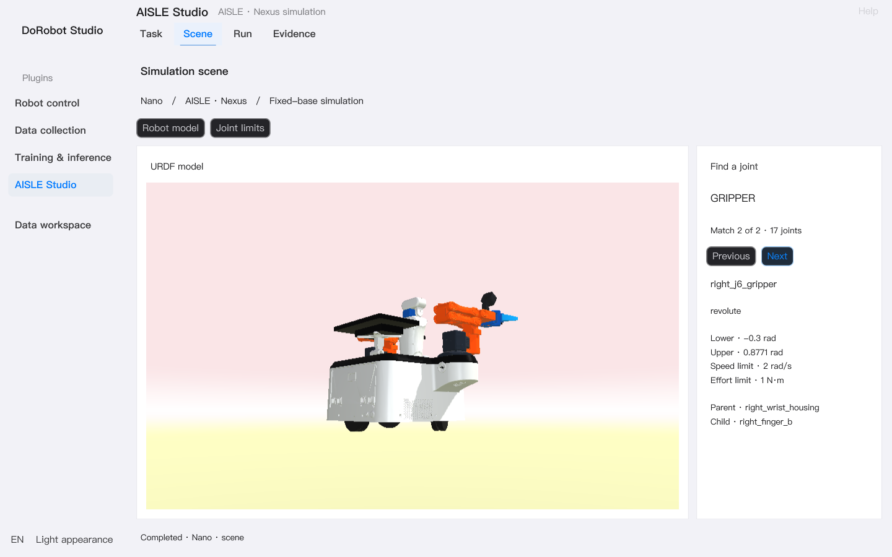
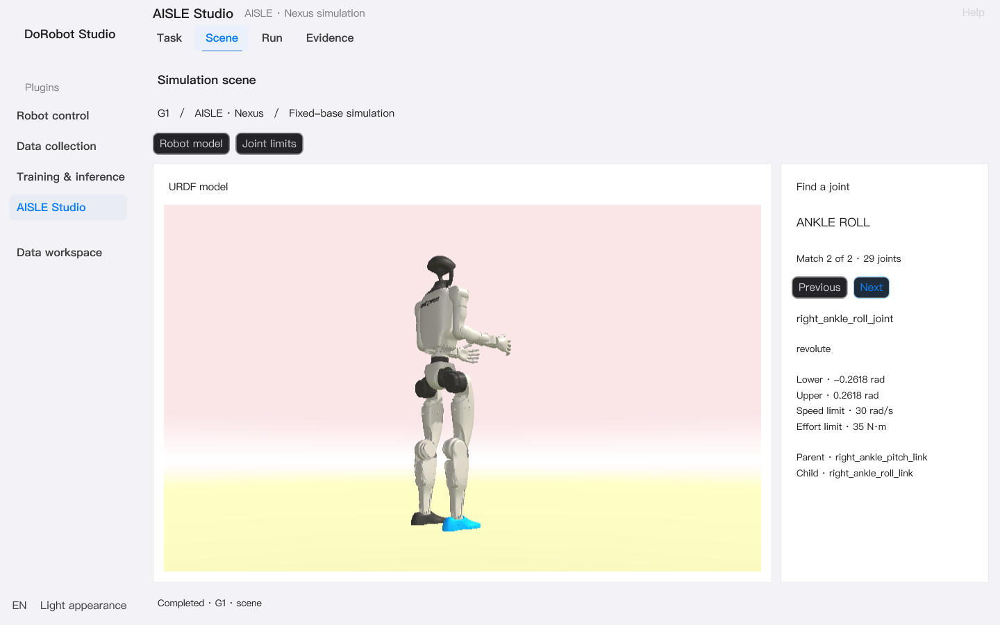

# Inspect Nano and G1 joint limits in Scene

Select **Nano** or **G1** on **Task**, open **Scene** and choose **Joint limits**. The panel reads the selected robot’s URDF. Selecting a joint marks its origin and tints its child link blue. The panel shows the joint type, parent and child links, angular position range, maximum speed and maximum effort.

- Enter `gripper` for the two Nano grippers. Use **Next** to select the right gripper. Its URDF range is −0.3 to 0.8771 rad, its speed limit is 2 rad/s and its effort limit is 1 N·m.
- Enter `wheel` for the three Nano base wheels. Each has continuous rotation with a speed limit of 5.45 rad/s and an effort limit of 1.86 N·m.
- With G1 selected, enter `ankle roll` and choose **Next** for the right ankle. Its URDF range is −0.2618 to 0.2618 rad, its speed limit is 30 rad/s and its effort limit is 35 N·m.

The search accepts uppercase or lowercase words. An empty result clears the marker and details. **Robot model** returns to the fixture controls. Browsing a joint leaves its pose unchanged. Actual encoder motion and task limits can be inspected in the scored trial on **Evidence**.

| Nano right gripper | G1 right ankle |
| --- | --- |
|  |  |

## Native verification

| Task author | Makepad backend and window | Joint inspections | Restart |
| --- | --- | --- | --- |
| DeepSeek through Octos | Offscreen, 1440 × 900 | 17 Nano, 29 G1 | Restored the selected G1 trial and exported episode, then opened the later stopped run |
| Codex | Headless, 1024 × 768 | 17 Nano, 29 G1 | Restored the selected G1 trial and exported episode, then opened the later stopped run |

The native driver selected all 46 joints in each window and compared their names, links, units and limits with an independent XML parse. It also checked the selected joint in the robot viewer, searched both models, and verified the empty result. In the offscreen robot viewport the selected gripper added 243 blue pixels and the G1 ankle added 778 against their respective cleared selections. Each completed G1 episode reopened in the native Replay player with 25 frames.

From the repository root, run the following to compare the retained labels with the two URDFs and verify the screenshots. The check uses NumPy and Pillow.

```sh
python3 docs/product/aisle-studio/validation/joint-inspector/check.py
```

To repeat the live journeys after setting up the Studio worker and author credentials, use a fresh output directory for each run. [Build and runtime setup](../../README.md)

```sh
.venv-aisle/bin/python tools/aisle_workbench/verify.py --studio target/debug/dorobot-flex --remote makepad-remote --backend offscreen --size 1440x900 --octos-deepseek --out /tmp/studio-joints-deepseek
.venv-aisle/bin/python tools/aisle_workbench/verify.py --studio target/debug/dorobot-flex --remote makepad-remote --backend headless --size 1024x768 --codex --out /tmp/studio-joints-codex
```

Each native run records its binary digest, source revision, session timestamps, displayed labels and restored trial identities. [Retained native measurements](native.json)
