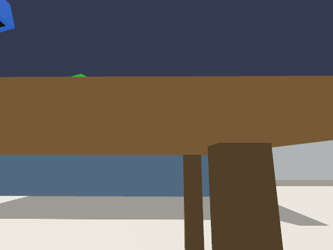
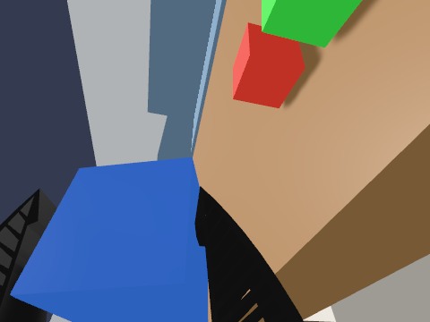
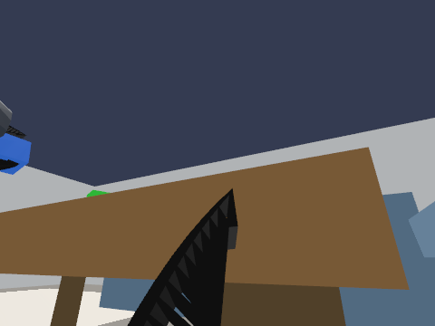
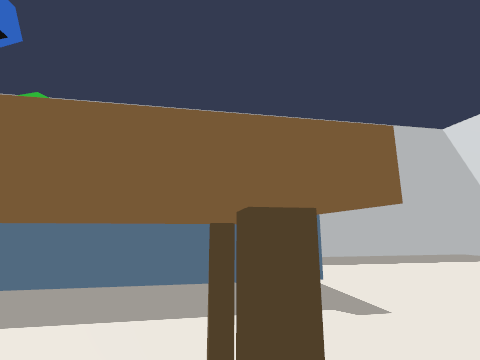
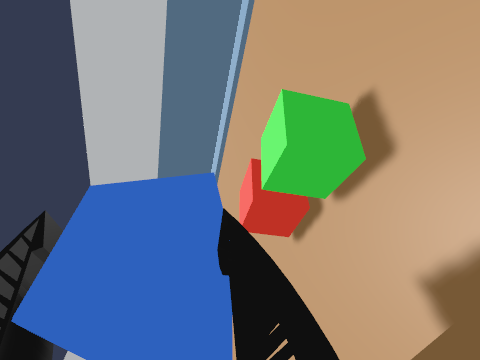
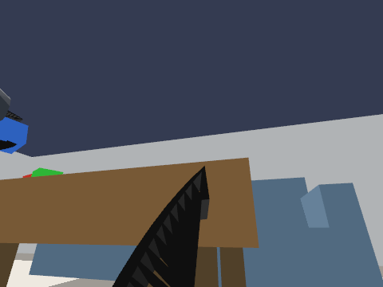

# Finding a reachable release point on the Nano coffee table

On the 50 previously concealed cohort E layouts, the experimental three-camera controller completed 40 three-cube transfers. It stopped during placement in five layouts because its left arm could reach no release point meeting the camera clearance rule. Replaying each of those five layouts with exposure recording produced identical motor journals, physical verdicts and per-cube measurements. All five motor journals verified with zero guard bypasses. These disclosed layouts are development cases. [Protocol](protocol.md) · [Original evaluation](../transfer-wrist-timing/README.md)

## What the Nano saw

At the blocked decision the Nano had three synchronized 480 × 360 RGB images, measured encoders, camera calibration and an estimate of the visible table rim. The arm planner checked the incoming closed-jaw path and the open-jaw withdrawal. A target needed at least 85 mm of observed table inset and 78 mm of clearance from each observed earlier cube.

| Original layout | Cube held | Nearest projected earlier cube after a hypothetical 8 cm move to the right |
| --- | --- | ---: |
| 9 | Blue | 97 mm |
| 15 | Green | 87 mm |
| 16 | Green | 90 mm |
| 19 | Green | 86 mm |
| 36 | Blue | 89 mm |

In all five stationary poses, the search returned zero acceptable slots. The last column is a geometric prediction from the failed decision's saved sensor inputs. A new pose must be reached in the simulation and measured again before the gripper can open. The independent judge observes loaded finger and table contact, continuous wheel support, joint limits and final cube motion.

To reproduce the geometric predictions, use Studio revision `7ef0206` or the same release-candidate search, URDF and calibrated projection code. The values in the table were computed offline from the original packets with that revision. Use the Studio AISLE Python environment from the repository root. The archive contains each action, the three RGB inputs and measured joint encoders at each marked release decision, the calibrated cameras, motor targets and the final scoring records.

```sh
DIR=docs/product/aisle-studio/validation/nano-release-workspace
python "$DIR/inspect_release.py" "$DIR/original/evidence.zip"
python tools/aisle-validation/nano_suite_evidence.py verify "$DIR/original/evidence.zip" \
  --manifest-sha256 0eac7bcc33733163c1f6e6ea86abebe7b245906a5be2634e3000f8258fb8d8cd
```

## Reproduce a disclosed layout in Studio

Each trial below uses the simulated Nano. In **Task**, select **Nano** and enter “Move all three floor cubes onto the coffee table in red, green, blue order. Use experimental wrist clearance.” Choose **Ask Codex** or **DeepSeek via Octos**. In **Scene**, enter the numeric layout seed and click **Set seed**. The label shows the active layout. Seeds from 0 to 4294967295 are supported. Invalid input preserves the previous layout. **Run → Start simulation** executes that layout. **Evidence** shows the independent result and can export the episode. The selected seed survives a Studio restart. If the saved value is unreadable, Scene returns to layout 0 and reports the fallback. [Scene with seed 3856023877 selected](custom-layout.png)

The agent authors the task and chooses the requested placement mode. The local controller watches the table, plans the arm movements and sends each bounded motor command. A release decision uses the onboard images, camera calibration and robot encoders. The judge records contacts and settled cube positions separately.

## Development experiments

| Method | Complete transfers on the five original refusals | Outcome |
| --- | ---: | --- |
| Original stationary placement | 0/5 | No slot passed both reachability and camera clearance. |
| Straight 8 cm wheel sidestep | 0/5 | The measured table heading changed too far during sideways wheel motion. All five trials stopped. All four control layouts passed. |
| Slower sidestep with steering feedback | 3/5 | Recovered layouts 9, 15 and 19. On 16 and 36, no target passed the final camera and arm checks. |
| Turn in place with landmark matches between the first and last images | 2/5 | Recovered layouts 9 and 36. On 15 and 19, the visible wrist camera changed. On 16, all three cubes settled, but the robot had already lost loaded wheel contact for one simulation tick. |

The archived development attempts include the full motor and camera evidence and a source patch for each alternative against commit `93d67f4`. The selected turn uses the robot’s existing steering control. It registers complete silhouettes between consecutive camera exposures so that an earlier cube can pass from one wrist’s view to the other. It retains earlier detections when they become occluded. An interrupted observation chain stops the turn. [All three exploratory attempts and control layouts](development-attempts.zip)

The continuous landmark tracker recovered layout 36 and completed one of the five original failures. It stopped on 9 because the apparent displacement between frames was inconsistent and on 15 and 19 because consecutive views had no common complete silhouette. All three cubes settled on 16, which still failed continuous wheel support. All five motor journals verified with zero guard bypasses. All four control layouts passed. The original motor journals matched byte for byte on the three disclosed control seeds from cohort E.

Open **Evidence → Evaluations**, select `tracked/evidence.zip` as the current archive and `original/evidence.zip` as the baseline, then click **Compare archives**. Keep each adjacent `suite.json` in its own directory. The native comparison counted one gain, four layouts failing both and zero regressions. It reopened the same comparison after restart. [Original capture](original/evidence.zip) · [Tracked turn](tracked/evidence.zip) · [Native comparison](matched-development.png) · [Instrument checks](native-comparison.json)

### Onboard views during the successful turn

In layout 36, the Nano was holding blue with red and green already on the table. The first exposure was taken at 264.12 s of simulation time. After a turn of about 11.3°, it measured the rim again at 265.92 s. Its observed standoff changed by 6 mm. The robot combined two fresh detections with three retained detections and chose a release 105 mm inside the observed near edge. A cube can appear in more than one camera, so the detection count can exceed the physical cube count. All three cubes remained in direct tabletop contact for the final 100 physics ticks.

| Simulated time | Head | Left wrist holding blue | Right wrist |
| --- | --- | --- | --- |
| 264.12 s |  |  |  |
| 265.92 s |  |  |  |


## Input commitments and recorded output

Cohort F was registered in commit `e1e8046` before dispatch. The manifest commits the executable inputs, controller and 50 concealed layouts. Independent scoring requires 45 complete transfers, 50 verified motor journals and zero guard bypasses. [Cohort F input manifest](cohort-f/suite.json)

The adjacent `evidence.zip.sha256` receipt covers the entire completed archive, including its RGB and encoder packets. Keep the published receipt beside its archive for command-line or native verification. A trusted hash can also be supplied with `--archive-sha256`. The verifier checks the marked exposure timestamps against the files in the archive. Download the input manifest and completed-output receipt from the published revision. [Baseline output receipt](original/evidence.zip.sha256) · [Tracked-turn output receipt](tracked/evidence.zip.sha256)


The native Codex run placed red on layout 3006510755 in 11,286 ticks. A separate local fleet worker accepted the same seed and reproduced that motor journal. DeepSeek through Octos placed all three cubes on layout 3856023877 in 28,802 ticks. Its journal matched the Codex-authored cohort run on that layout. Both native processes reopened their result after restart, and both exported LeRobot episodes retained the exact seed in `meta/aisle.json` under `simulation_source.seed`. The archive includes both controllers, measured motor commands, output metadata, native instrument receipts and the fleet lease. [Native and fleet evidence](native-seeds.zip) · [Independent seed and motor check](verify_native_seeds.py)

The native Evidence instrument also rejected a copy with a changed camera packet and restored the preceding verified comparison after restart. [Tampered-capture test](native-output-integrity.json)
