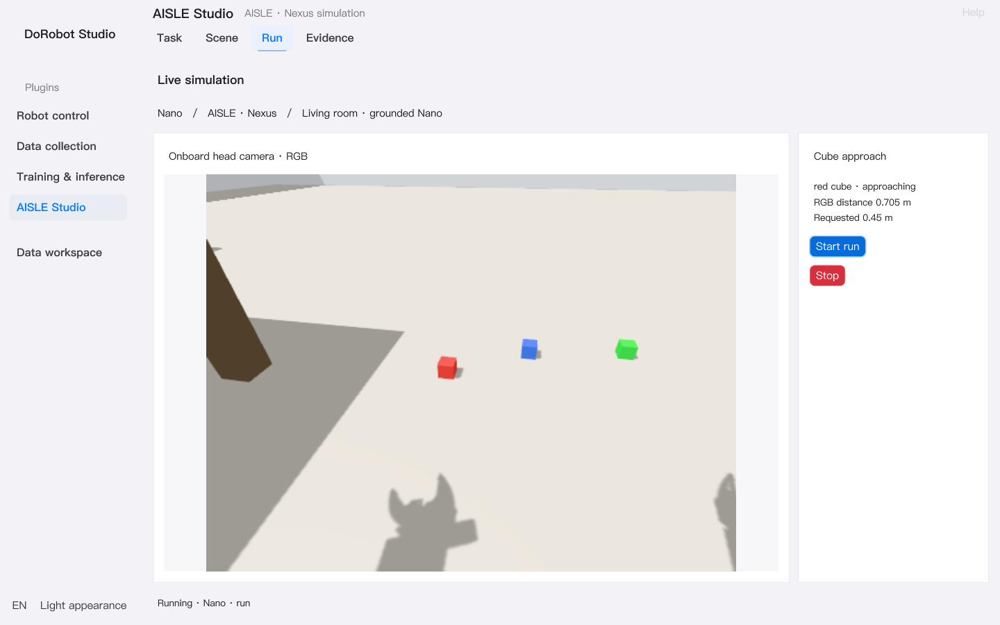

# Nano cube approach with DeepSeek and Octos

In **AISLE Studio → Task**, select **Adora Nano**, enter “Drive within 45 cm of the red floor cube and stop” and choose **DeepSeek via Octos**. The prepared controller shows the selected color, stopping distance and reported model. **Scene** identifies the floating-base living room. Choose **Run → Start run** to watch the head camera and range estimate update as the wheels move. **Evidence** shows the independent final distance, contact counts and a trace of the range estimated from RGB.

The live capture below comes from the Makepad app during the red-cube trial. The recording contains all 23 head-camera observations at the simulator’s 5 Hz observation cadence. [Head-camera video](nano-rgb-approach.mp4) · [Run archive](nano-rgb-approach.zip)



## What each component controls

1. Octos invokes DeepSeek once to translate the request into the typed visual-approach controller. The Studio worker checks the capability, selected robot, color and stopping distance against the local limits. Codex can author the same controller through **Ask Codex**.
2. The Nano has a floating base, three driven wheel joints and the extended-arm URDF. AISLE runs Nexus on Metal with gravity at 9.81 m/s². The wheel servo accepts up to 5 rad/s and limits each update’s change to 1 rad/s. It advances the simulation at 100 Hz.
3. A separate visual-servo process receives one timestamp, 17 measured encoders and three synchronized onboard RGB arrays per observation. It also receives the versioned robot model and nominal camera calibration. It detects colored image regions and uses camera rays, encoder-derived forward kinematics, the planar floor assumption and the 40 mm cube size to estimate position relative to the base. Missing, ambiguous or inconsistent observations request a stop. Each new sensor packet updates the command.
4. The evaluator independently reads base and cube poses, plus wheel, floor and obstacle contacts. It checks final range within 3.5 cm of the request, final bearing within 0.12 rad, actual base travel, three stationary observations, wheel support on every rollout tick, obstacle contacts and sampled joint limits. The evidence folder retains synchronized sensor packets and the evaluator trace. The model authoring a revision can receive the previous RGB-derived range and servo state.

## Measured on this Mac

| Provider and entry point | Development layout | Requested | Measured stop | Wheel-supported ticks | Authoring time |
| --- | --- | ---: | ---: | ---: | ---: |
| DeepSeek via Octos, Makepad offscreen | 0 · red | 45 cm | 46.81 cm | 460/460 | 1.88 s |
| Codex, Makepad headless | 0 · red | 45 cm | 46.81 cm | 460/460 | 7.13 s |
| DeepSeek via Octos, worker CLI | 1 · green | 42 cm | 43.70 cm | 520/520 | 1.61 s |
| DeepSeek via Octos, worker CLI | 2 · blue | 50 cm | 51.65 cm | 520/520 | 1.54 s |
| DeepSeek via Octos, revision from red trial | 0 · red | 41 cm | 42.71 cm | 500/500 | 1.59 s |

The two red-cube traces have the same SHA-256. Both models selected the same parameters and the local visual servo executed both trials. Each retained pair of successive Run-page observations was read while physics was active. Each native journey passed 30 checks plus two restart checks. All five runs recorded zero obstacle-contact ticks. The largest measured localization error across the three layouts was 7.9 mm. Authoring times include the CLI and network and come from one call per row. [Inputs, provider metrics, outcomes and trace hashes](nano-rgb-trials.json)

For the red revision, the operator asked to stop 4 cm closer than the previously requested distance. DeepSeek received the previous controller hash, target and RGB-estimated distance. It selected the same red cube and changed 45 cm to 41 cm. In a separate check, both providers rejected a request to pick up all three cubes and carry them to the table before issuing a controller.

The development trials start with the target in view on an unobstructed floor. They exercise visual approach and braking. The three-cube qualification still needs search under occlusion, grasp and lift, table localization, release, settled placement and 50 sealed layouts. Physical Nano calibration and deployment remain separate.

## Reproduce

Follow the [Studio runtime setup](../README.md) and select an authenticated Octos DeepSeek profile when needed. From the Studio repository root, this command runs a new development layout through the same authoring and visual-servo code.

```sh
.venv-aisle/bin/python tools/aisle-validation/run_rgb_approach.py \
  --task "Approach the blue floor cube and stop 50 cm from it." \
  --seed 2 --out /tmp/nano-blue-approach
```

Use `--provider codex` for the matched authoring comparison. To replay the published red trial from the recorded sensor packets, run the following with a fresh directory. The verifier checks the robot model digest and compares every reconstructed servo decision against the recorded command.

```sh
replay_dir=$(mktemp -d)
unzip -q docs/product/aisle-studio/validation/nano-rgb-approach.zip -d "$replay_dir"
PYTHONPATH="$DOROBOT_AISLE_ROOT/src" .venv-aisle/bin/python tools/aisle-validation/verify_rgb_replay.py "$replay_dir"
```
