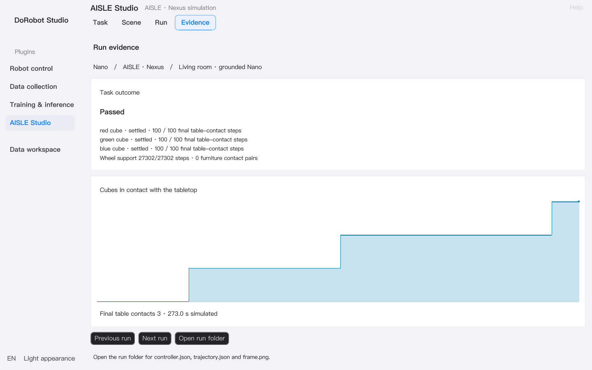
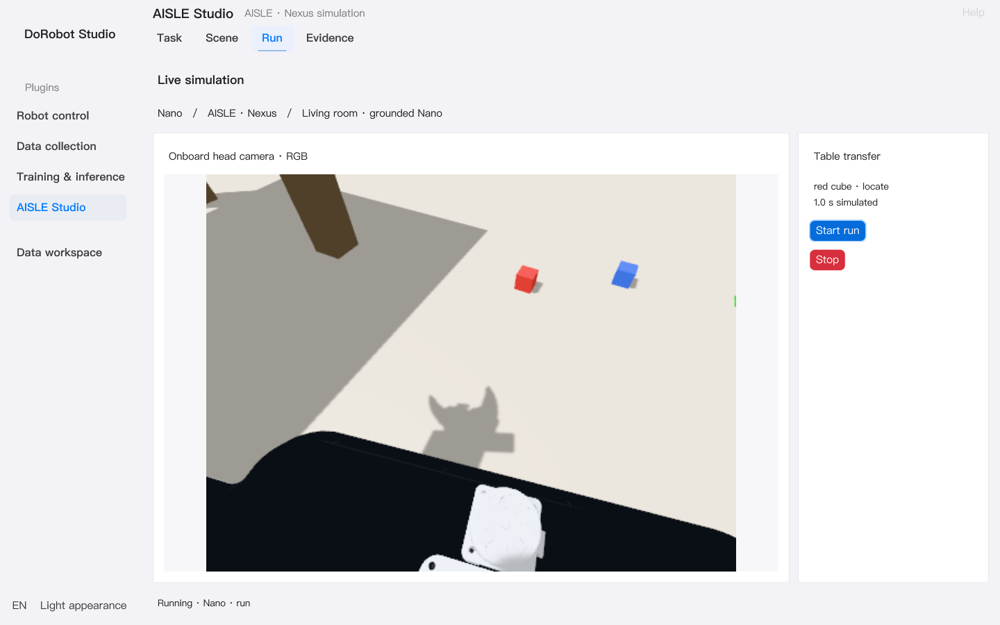
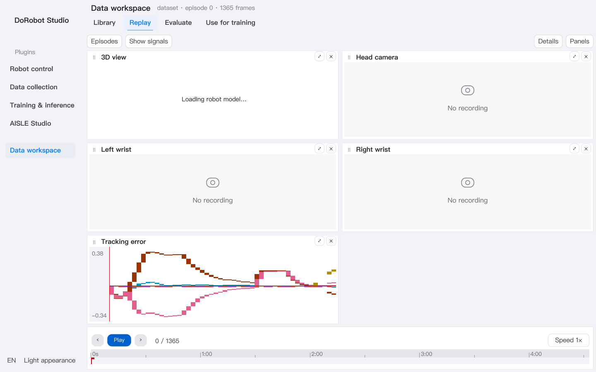

# Move floor cubes to the coffee table with DeepSeek and Octos

Open **AISLE Studio → Task → Adora Nano**. Enter “Move all three floor cubes onto the coffee table in red, green, blue order” and choose **DeepSeek via Octos**. To run one cube, enter “Move the red floor cube onto the coffee table.” Read the order and model on Task. On Scene choose a development layout (0, 1 or 2) and inspect the Nano model. Then select **Run → Start run**. Evidence records the selected layout. Run shows the live head camera and current phase. Evidence lists a verdict for each requested cube and the number of physics steps with tabletop support during the final second. Open the run folder for the three onboard views at each phase and the independent evaluator measurements.

Configure the [Studio runtime](../README.md) first. The local arm solver also requires SciPy. The tested Octos installation uses a stored DeepSeek profile. Substitute your profile name in the following commands.

```sh
uv pip install --python .venv-aisle/bin/python scipy==1.18.1
export DOROBOT_OCTOS_PROFILE=dsflash
cargo run --locked -p dorobot-flex --bin dorobot-flex -- --screen aisle-task
```

## Who makes each decision

| Component | Input | Output |
| --- | --- | --- |
| DeepSeek via Octos | Operator instruction, supported task schema, optional public verdicts from a selected run | One reviewable controller revision specifying the capability and cube order. Studio checks the reported model, robot and allowed fields. |
| Local controller | Calibrated head and wrist RGB, timestamp, 17 encoders and robot URDF | Searches for a floor cube, aligns the wheels, plans the bounded left-arm grasp, checks the jaws in the wrist image, estimates the table rim from two camera views, docks and releases. A lost grasp can trigger a fresh visual search in the same episode. |
| AISLE and Nexus | Guarded wheel and joint commands | Advances a floating-base robot and three free cubes at 100 Hz. Gravity, finger contact and the tabletop determine where each cube ends up. |
| Independent evaluator | Current solver impulses, collision geometry, object motion, joint measurements | Checks load between both fingers during lift, continuous wheel support, robot–furniture contact, tabletop support, clearance from the released cube and final motion. World poses stay in evaluator artifacts. |

The inner controller assumes 40 mm colored cubes on a level floor, nominal camera calibration and a visible brown horizontal table rim. During carry the left gripper holds the cube while the head and right wrist estimate the table height and distance. Table detection, lighting changes and partially occluded grasps are development limitations. A revision can change the requested sequence and reuse a previous verdict. Changes to the low-level grasp and navigation software require a separate code revision.

## Repeat through native Makepad instrumentation

Build Studio and the pinned Makepad remote client using the [workbench instructions](../README.md). Each invocation needs its own output directory.

```sh
.venv-aisle/bin/python tools/aisle_workbench/verify.py \
  --studio target/debug/dorobot-flex --backend headless --size 1024x768 --dark \
  --octos-deepseek --transfer red --out /tmp/aisle-nano-red

.venv-aisle/bin/python tools/aisle_workbench/verify.py \
  --studio target/debug/dorobot-flex --backend offscreen --size 1440x900 \
  --octos-deepseek --transfer three --out /tmp/aisle-nano-three
```

The driver types the instruction, selects the provider, inspects the scene, starts the run, observes two live updates and opens Evidence. A failed task produces a nonzero exit and retains its measurements. After a successful run the driver restarts Studio and checks that Evidence restores the verdict. Add `--layout 1` or `--layout 2` to test another starting arrangement. For a matched Codex run, select **Ask Codex** in Task or use `--codex` in the verification command.

## Matched provider runs

Both models received the same operator text on development layout 0. The three-cube trials ran continuously without moving the robot root, resetting the scene or attaching an object to the hand. The two providers produced byte-identical action logs for each matched task. The times below cover one authoring call per cell, including the CLI and network. Nexus ran the local controller after authoring.

| Operator task | DeepSeek v4 Flash via Octos | Codex GPT-6.2 Astra | Independent verdict |
| --- | ---: | ---: | --- |
| Move the red cube | 2.22 s, Makepad headless | 8.25 s, Makepad offscreen | Red settled. Wheels supported all 6,728 steps. |
| Move all three in red, green, blue order | 1.61 s, Makepad offscreen | 11.15 s, Makepad headless | All three settled. Wheels supported all 27,302 steps. |

Each cube center finished at 0.560 m above the world origin on a 0.540 m tabletop. For the final 100 consecutive 10 ms steps, the table bore load from every cube, neither finger bore its load, and the conservative minimum finger clearances were 28.1 cm (red), 26.0 cm (green) and 28.7 cm (blue). All cubes remained inside the tabletop and their measured settling displacement was below 3 mm. The evaluator recorded zero robot–furniture contacts and zero measured URDF joint-limit excursions.

The active controller used 545 observations, including a second visual search and pickup after blue slipped. The evaluator uses current normal solver impulses for load. In development we observed Nexus retain cached contact manifolds after a finger had moved clear. The release check therefore also requires positive separation from both URDF finger collision bounds. Furniture contacts retain a conservative manifold check. [Controller revisions, provider calls, trial verdicts and action-trace hashes](nano-table-transfer-trials.json)



## Failures and revisions

An earlier three-cube Studio run correctly failed with two cubes settled. On a second blue grasp, the wrist detector rejected a cube resting near the edge of the opening. Separately, DeepSeek received the public per-cube verdicts and the request “move only the cube that failed to settle.” It selected blue in 2.16 s and the resulting blue-only run passed. That retry used a new scene. The local perception change for the successful continuous run was an engineering change to the wrist classifier. Both experiments are in the trial records.

On a second development layout, the original release motion left green resting on the open lower finger. It returned to the floor when the arm withdrew. The evaluator scored red and blue as settled and the complete task as failed. This is a separate development layout; the PRD qualification calls for at least 45 complete successes across 50 hidden layouts.



## Replay and dataset handoff

[Watch the complete run from the three onboard cameras at 6× speed](nano-table-transfer.mp4) · [Download the LeRobot v2.1 episode](nano-table-transfer-lerobot.zip) · [Export manifest, file hashes and native checks](nano-table-transfer-recording.json)

On Evidence, choose **Export episode**, then **Open in Replay**. To open the published example independently, unpack the ZIP and open its `dataset` directory in Studio. The episode contains 1,365 synchronized 480 × 360 frames from each of the head, left wrist and right wrist cameras at 5 Hz. Each Parquet row carries all 17 measured joint positions and their commanded positions in radians. The command includes the integrated wheel position targets sent to the motors. Dataset time zero is the first recorded sample, at simulation step 20. The final sample is step 27,300. The trial’s separate `actions.jsonl` records its irregular policy observation and action times.

Native instrumentation checked the decoded frame count and dimensions of each MP4, every recorded state and action against Parquet and all sample timestamps. It then opened the episode in the existing Studio Replay page. Camera calibration, controller identity, model hashes and the physical verdict accompany the exported episode.



## Development layouts after the release correction

The controller now checks the wrist RGB image after it opens and withdraws. If the cube is still on the fixed finger, it returns to the observed tabletop and tips that finger so gravity can release the cube. The same synchronized exposure supplies the next tabletop check. The controller solves the full sequence of arm waypoints before sending its first command.

The final regression ran the same policy and evaluator bytes on development layouts 0, 1 and 2. These layouts were available during development. [Complete per-cube results and earlier failed attempts](nano-transfer-development-layouts.json)

| Layout | Whole task | Cubes meeting every placement criterion | Wheel-supported steps |
| --- | --- | --- | ---: |
| 0 | Passed | red, green, blue | 27,302/27,302 |
| 1 | Passed | red, green, blue | 24,706/24,706 |
| 2 | Failed | red, green | 23,024/23,024 |

On layout 2, blue settled with 100 consecutive tabletop-load measurements. Its center was only 15.8 mm inside the front edge, below the required 35 mm inset. The scorer retained a whole-task failure. The sealed qualification of 45 complete successes in 50 layouts remains open. Operators can reproduce the three development layouts from Scene. The native selection check exported layout 2’s red-only trial and reopened it in Replay.

The subsequent guarded controller places the cube farther inside the observed rim and keeps the arm elevated until reverse wheel travel confirms table clearance. On development layout 2, the complete DeepSeek-authored offscreen task passed. All 23,244 post-initialization physics steps had one journaled motor vector, grounded wheels and valid actuator commands. The smallest final cube-center margin was 48.9 mm. The native journey exported the episode, opened Replay and recovered the verdict after restart. [Guarded layout 2 measurements](nano-layout2-guarded.json)
