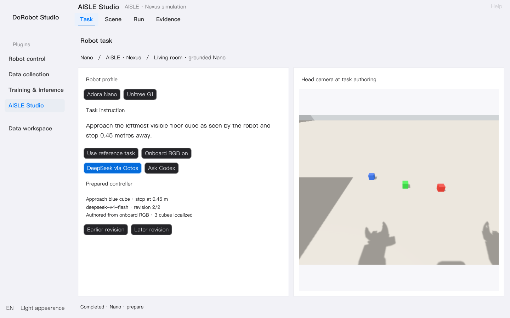

# Author a task with Nano’s onboard view

Enable **Onboard RGB** on the Nano Task page, select the development layout on Scene, then enter “Approach the leftmost visible floor cube as seen by the robot and stop 0.45 metres away.” Choose **DeepSeek via Octos** or **Ask Codex**. Task displays the captured head-camera image and the color selected by the model. **Run** executes the controller in the selected Nexus scene.



Nano captures all three RGB cameras and 17 joint encoders. The local detector uses the calibrated camera rays, encoder-derived camera poses and the nominal floor-cube height to estimate horizontal range and left/right position in the robot frame. The model receives the resulting measurements and visibility for red, green and blue. Studio retains the original pixels for inspection. The model receives no layout number, engine object coordinates, depth image or segmentation labels. Changing the selected layout, surveyed room or relevant source code invalidates the observation-bound controller.

| Layout | Both providers selected | Independent final range | Grounded physics steps |
| --- | --- | ---: | ---: |
| 0 | Red | 0.4681 m | 460/460 |
| 1 | Blue | 0.4677 m | 600/600 |

Each provider ran both cases in a fresh Studio session. Each run measured zero obstacle contacts. The native driver also changed the scene, confirmed the old controller was rejected before motion and recovered the successful replacement trial on restart. The same local wheel servo interpreted fresh RGB while driving in all four runs. [Provider calls, controllers and headless/offscreen measurements](native-trials.json)

The archived packets contain raw camera pixels, 17 encoder readings and a capture timestamp. The accompanying calibration supplies camera intrinsics and rigid transforms. [Layout 0 packet](layout-0-onboard-scene.npz) · [calibration](layout-0-onboard-calibration.json) · [model input](layout-0-onboard-scene.json). [Layout 1 packet](layout-1-onboard-scene.npz) · [calibration](layout-1-onboard-calibration.json) · [model input](layout-1-onboard-scene.json).

## Reproduce through native Studio

Use the Python environment, AISLE checkout and Makepad remote client from the [workbench setup](../../README.md). Set `PYTHONPATH` to the AISLE `src` directory for the independent observation decoder in the journey.

```sh
.venv-aisle/bin/python tools/aisle_workbench/verify.py \
  --studio target/debug/dorobot-flex --backend offscreen --size 1440x900 \
  --observed-author --octos-deepseek --out /tmp/nano-observed-deepseek
```

Use `--codex` and a fresh output directory to repeat the same task with Codex.
