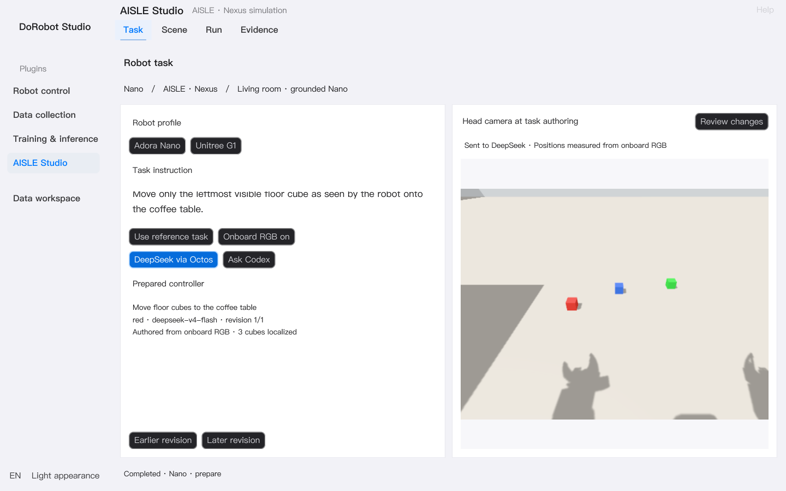
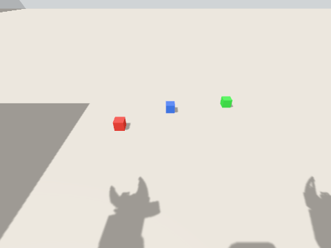
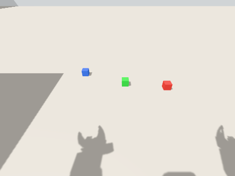

# Use Nano’s cameras to choose the cube

In native Studio, open **Task**, select **Nano**, and enable **Onboard RGB**. On **Scene**, select a living-room layout. Return to **Task** and enter “Move only the leftmost visible floor cube as seen by the robot onto the coffee table.” Select **Ask Codex** or **DeepSeek via Octos**. Task shows the head-camera exposure, the chosen cube and which inputs Studio sent. Open **Run** to execute the prepared controller and **Evidence** to inspect the transfer.



Nano captures its three 480 × 360 RGB cameras and 17 encoders together. Studio uses the calibrated camera rays and the observed joint positions to estimate each visible cube’s forward and lateral distance. Both authors receive camera calibration, visibility and these robot-frame measurements. Codex also receives three lossless PNGs in head, left wrist, right wrist order. The tested DeepSeek/Octos integration sends the worksheet and calibration as text. The request and each image hash are retained with the controller. A different layout or room revision requires a fresh capture before Run accepts an observed controller.

## What the same instruction produced

| Living-room layout | Initial onboard head view | Codex | DeepSeek through Octos | Wheel support per transfer |
| --- | --- | --- | --- | --- |
| 0 |  | Placed red | Placed red | 6,848 / 6,848 ticks |
| 1 |  | Placed blue | Placed blue | 6,948 / 6,948 ticks |

Each provider independently produced a controller for each layout. AISLE’s local feedback controller drove the base and arms in Nexus. The selected cube had opposing-finger contact while airborne for 3,182 ticks on red and 3,123 on blue. It detached and maintained table contact for the final 100 ticks in each run. For each layout, both authors’ motor journals were byte-identical. All four transfers recorded zero robot–furniture contact, joint-limit excursion, root-pose writes and rejected motor writes. Studio rejected the outdated controller before motion after each layout switch and reopened each provider’s last trial after restart. These four transfers measure one relative instruction on two development layouts. The PRD tracks the separate hidden-layout three-cube qualification.

In a separate perception test, Codex received the same three images with an identical question on both layouts. We withheld the calibration and worksheet. It answered red, then blue. Independent measurements put the leftmost cube at x = 173 and 174 pixels respectively. This experiment isolated perception. The four physical simulations in the table used the full inputs described above.

A separate local fleet worker received the first Codex controller, rejected a changed image at submission, and then ran the original request. Studio downloaded and reopened the completed archive, verified all three PNGs against their captured pixel arrays and recovered a motor journal identical to the native red transfer. The worker used the same Mac and AISLE revision. [Recorded inputs, replies, motor journals and fleet verification](evidence.zip)

## Reproduce

Follow the [workbench setup](../../../README.md) to build Studio, install the AISLE environment and configure the selected providers. Export `DOROBOT_AISLE_ROOT`, `DOROBOT_AISLE_PYTHON` and `PYTHONPATH="$DOROBOT_AISLE_ROOT/src"`. Supply the path to the built Makepad remote client with `--remote` if needed. Each verification writes a new output directory.

```sh
.venv-aisle/bin/python tools/aisle_workbench/verify.py \
  --studio target/debug/dorobot-flex --backend headless --size 1024x768 \
  --observed-author transfer --codex --out /tmp/nano-observed-codex

.venv-aisle/bin/python tools/aisle_workbench/verify.py \
  --studio target/debug/dorobot-flex --backend offscreen --size 1440x900 \
  --observed-author transfer --octos-deepseek --out /tmp/nano-observed-octos
```

Use the following commands from the repository root to audit the bundled evidence offline, repeat the image-only question through Codex, and send a real simulation through a separate local fleet worker. The two preparation directories must be in layout order.

```sh
guide=docs/product/aisle-studio/validation/onboard-authoring/camera-inputs
.venv-aisle/bin/python "$guide/audit.py"
set -- /tmp/nano-observed-codex/state/aisle/*-Nano-prepare
.venv-aisle/bin/python "$guide/sight_check.py" "$1" "$2" --out /tmp/nano-pixels
.venv-aisle/bin/python "$guide/fleet_check.py" "$1/controller.json" --out /tmp/nano-fleet-pixels
```
