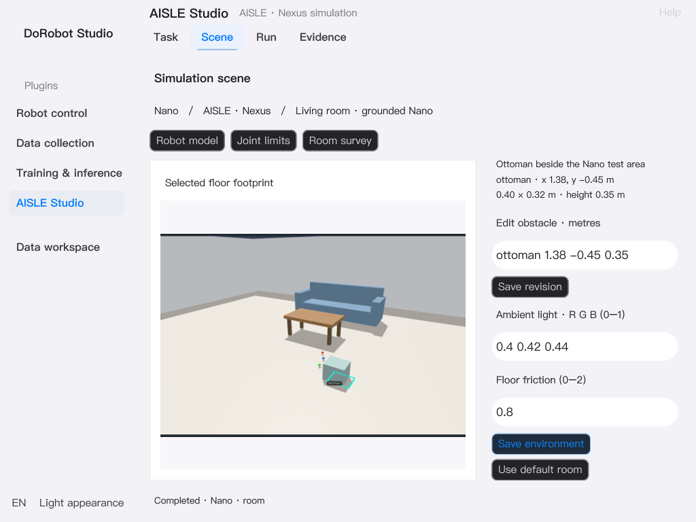

# Change the lighting and floor friction in a Nano room

1. Prepare a Nano table-transfer or visual-approach task. Open **Scene → Room survey** and import the [example survey](../room-survey/survey.json), or select a room you have already reviewed.
2. Scroll to **Ambient light** and **Floor friction**. Studio displays the selected room’s values. Ambient light takes three space-separated red, green and blue intensities, each between 0 and 1. Floor friction takes a coefficient between 0 and 2. Clear a field to restore the Nexus fixture default.
3. Edit the desired field and choose **Save environment**. Studio creates a child revision containing the original surveyed geometry, reference photo and camera calibration. An invalid entry keeps the previous room selected. The footprint preview continues to show the surveyed photograph.
4. Run the same controller with the same layout seed on each revision. The camera stream shows the simulated lighting. Evidence retains the room hash, archived settings and physical verdict with the trial.



## Measured effects in Nexus

All three scenes used the real Nano URDF, the same calibrated head camera, layout 0 and the same edited ottoman position. We captured a 480 × 360 onboard RGB frame after settling and measured a separate material test. The evaluator gave the red cube an initial horizontal speed of 0.8 m/s and measured its displacement after 50 physics ticks (0.5 s). Each scene started in a fresh process.

| Room | Ambient R, G, B | Floor coefficient | Cube displacement |
| --- | --- | ---: | ---: |
| Survey baseline | 0.58, 0.60, 0.62 | 0.65 | 47.78 mm |
| Dimmer room | 0.40, 0.42, 0.44 | 0.65 | 47.78 mm |
| Dimmer room with higher floor friction | 0.40, 0.42, 0.44 | 0.80 | 41.56 mm |

Dimming the light changed the raw head-camera pixels by a mean absolute 11.58 levels on an 8-bit scale. Raising the floor coefficient shortened the slide by 6.21 mm. AISLE’s Nexus fixture uses the higher of the two colliding surface coefficients. With a cube coefficient of 0.70, changing the floor from 0.65 to 0.60 produced the same 47.78 mm slide in a separate check. [Original head RGB](head-original.png) · [Dimmed head RGB](head-dim.png) · [Room hashes and measurements](comparison.json)

## Reproduction

Use the project’s AISLE Python environment and the normal native verification command. Add the following options to run the environment journey.

```sh
--backend headless --size 1440x900 --octos-deepseek --transfer red \
  --survey docs/product/aisle-studio/validation/room-survey/survey.json \
  --edit-environment
```

The journey rejects friction 2.5 and saves the lighting and floor edits separately. Each successful save creates a folder under the verification output’s `state/aisle`. For the material and camera measurements, use the three successive `room.json` files for the edited geometry, changed lighting and changed friction.

```sh
python docs/product/aisle-studio/validation/room-environment/probe.py \
  --rooms "$BASE/room.json" "$LIGHT/room.json" "$FLOOR/room.json" \
  --seed 0 --out /tmp/nano-room-comparison
```

The probe verifies the revision hashes, geometry and camera settings, saves the raw head image for each condition, and writes the displacement and pixel differences to `comparison.json`.
