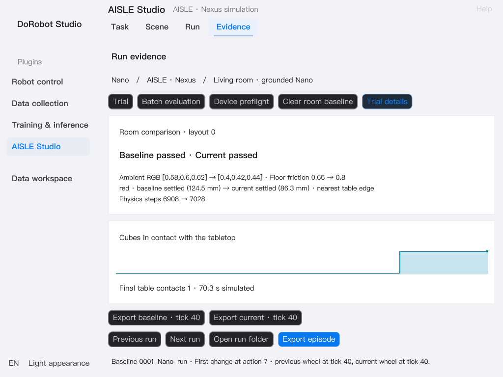

# Compare two Nano rooms on Evidence

1. Run a Nano table-transfer controller in a surveyed room. Save a lighting or friction edit and run the **same controller** on the **same layout seed**.
2. In **Evidence → Trial**, use **Previous run** to select the original trial. Choose **Use as room baseline**.
3. Use **Next run** to select the edited trial. Studio shows both verdicts, the changed settings, the cube’s final distance to the nearest table edge, and the number of physics steps. You can also pin the newer trial and compare an earlier run.
4. The footer identifies the first different recorded action. Choose **Export baseline** or **Export current** if the episode needs exporting, then select its **Replay** button. Replay opens paused at the recorded exposure associated with that action. **Clear room baseline** restores automatic same-room comparisons.



## What Studio checks

The pin identifies a run and its verdict hash. Before opening a room comparison, Studio verifies both archived controllers, room revisions, surveys and reference photos. It checks that the target, seed, URDF, geometry, camera calibration, policy and execution settings match. Lighting and floor friction may differ together or individually. With both changed, the task outcome describes their combined effect. If a check fails, Evidence names the mismatch and keeps the pin for another selection. The chosen baseline survives a Studio restart. Joint inspections and other task types keep their own comparison while a room is pinned.

## Measured pair

The same DeepSeek-via-Octos controller placed the red cube in both Nexus recordings on layout 0.

| Measurement | Original room | Edited room |
| --- | ---: | ---: |
| Final distance inside nearest table edge | 124.5 mm | 86.3 mm |
| Supported physics steps | 6,908 / 6,908 | 7,028 / 7,028 |
| First different action | 7, wheel command at tick 40 | 7, wheel command at tick 40 |
| Requested turn rate | 0.418485 rad/s | 0.419112 rad/s |
| Replay position | Frame 1 of 345, 0.20 s | Frame 1 of 351, 0.20 s |

Frame numbers and playback times start at zero. The two native checks used a 1440 × 900 headless window and a 1024 × 768 offscreen window. Each pinned a newer and an older baseline, rejected an intentionally damaged copy of the survey, exported both episodes and restored the baseline after restarting Studio. [Native measurements](paired-trials.json) · [Original and edited room settings, task verdicts and downloadable episode](README.md)

## Reproduce the native check

Use the project’s AISLE Python environment. Supply the two run folders containing the original `result.json`, `actions.jsonl`, `recording.json`, room inputs and camera exposures. The verifier copies them into a fresh Studio state directory.

```sh
python tools/aisle_workbench/verify.py \
  --studio "$STUDIO_BIN" --remote "$MAKEPAD_REMOTE" \
  --backend headless --size 1440x900 \
  --compare-runs "$ORIGINAL_RUN" "$EDITED_RUN" --room-baseline \
  --out "$NEW_OUTPUT"
```

To regenerate the original run using the controller from the [native environment-editing journey](README.md#reproduction), set `VERIFY_OUT` to that journey’s output and `ORIGINAL_RUN` to a fresh output folder. The following commands select the recorded candidate and follow its two accepted room edits back to the original condition.

```sh
STATE="$VERIFY_OUT/state/aisle"
EDITED_RUN="$STATE/$(jq -r . "$STATE/selected-trial.json")"
BASE_ROOM=$(python - "$STATE" <<'PY'
from pathlib import Path
import sys
sys.path.insert(0, "docs/product/aisle-studio/validation/room-environment")
from probe import selected_rooms
print(selected_rooms(Path(sys.argv[1]))[0])
PY
)
python tools/aisle_workbench/worker.py run --robot Nano \
  --controller "$EDITED_RUN/controller.json" \
  --controller-sha256 "$(jq -r .controller_hash "$EDITED_RUN/result.json")" \
  --room-revision "$BASE_ROOM" --room-hash "$(jq -r .sha256 "$(dirname "$BASE_ROOM")/room-ref.json")" \
  --seed "$(jq -r .seed "$EDITED_RUN/result.json")" --out "$ORIGINAL_RUN"
```
