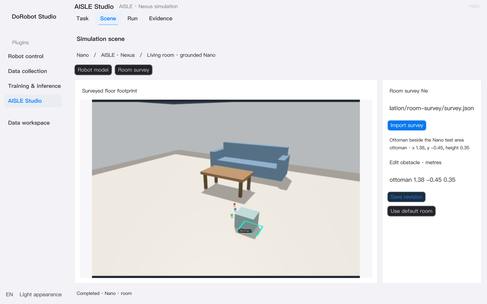

# Bring a surveyed room photograph into Nexus

In AISLE Studio prepare a Nano visual-approach or table-transfer controller. Open **Scene → Room survey**, enter the absolute path to the [example survey](survey.json) and click **Import survey**. Studio displays a floor outline over the photograph and lists each obstacle's center and height in metres. To move the example ottoman, enter `ottoman 1.38 -0.45 0.35` under **Edit obstacle** and choose **Save revision**. Run uses the selected revision. **Use default room** returns to the built-in recipe.

The example uses a [Nexus-rendered reference image](reference.png) with six surveyed floor marks. Its [camera fixture](camera-fixture.json) shifts the right wrist camera 3 mm along the mounting link. The lighting and friction settings are development perturbations. The image and camera fixture supply reproducible test data.

To use your own image, supply an upright PNG or JPEG, a short description, and at least five distinct floor marks with image coordinates in pixels and measured room coordinates in metres. The room origin is the initial Nano base, +X points forward and +Y points left. For each axis-aligned box, mark four footprint corners inside the surveyed area, give it a unique name and measure its height. Paths in the survey resolve relative to the JSON file. Studio fits a floor-plane homography, rejects calibration residuals above 20 mm and checks the geometry against the robot, furniture and starting cube layout. Edits use `name x y height`. The preview draws the edited floor outline over the original image.

An optional `camera_calibration` supplies a source description, the Nano URDF SHA-256 and all three 480 × 360 rectified cameras. Each camera supplies its mounting link, rigid `link_from_camera_gl` transform and centered pinhole intrinsic matrix. Nexus renders the declared mount and focal length. The reference image and surveyed geometry stay with the operator and evaluator. The controller receives calibrated onboard RGB, joint encoders and timestamps. Optional `ambient_rgb` and `floor_friction` values in `environment` set the actual sensor lighting and floor collider inputs.

Each accepted edit creates a new room directory containing the photo, portable survey, revision and annotated preview. Invalid edits preserve the previous selection. A run verifies the selected revision hash and archives its inputs with the episode. The measured obstacle centers come from the Nexus bodies. Lifting objects, nonplanar rooms, free-form mesh reconstruction and automatic object labeling would require additional reconstruction methods.

To estimate a camera mount from observations, supply its link-frame landmarks and upright RGB exposures in the calibration file. Studio shows how closely each fitted mount predicts independent image points. [Fit and validate the head and wrist camera mounts](camera-mounts.md)

The headless 1024 × 768 and offscreen 1440 × 900 journeys used the same binary built from clean revision `04ad148`. They imported the supplied fixture, rejected an overlap at the robot origin and ran the saved edit through DeepSeek via Octos. Each red cube settled 112 mm inside the rim after 6,988 physics steps. Both trials checked the fixed body's actual Nexus center at (1.38, −0.45, 0.1407) m and verified the onboard calibration against the selected revision. Both trials exported the three-camera episode, opened it in Replay and restored the selected scene and outcome after restart. [Native trials and hashes](native-trials.json)

