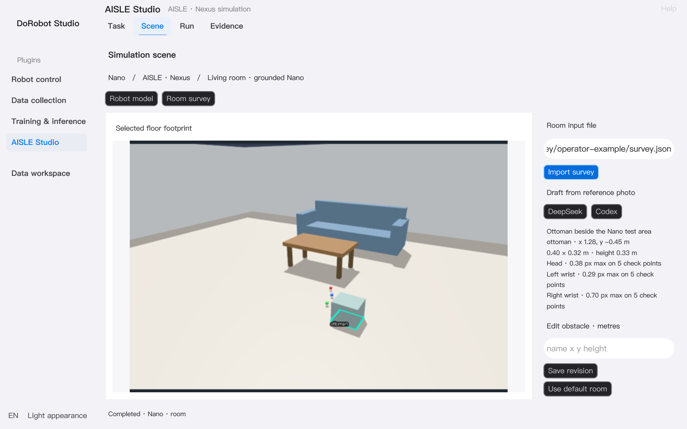

# Fit Nano's head and wrist camera mounts from RGB

In **Task**, select Nano and prepare a visual approach or a floor-to-table transfer. Unpack the [worked example with 42 original Nexus exposures](nano-camera-survey.zip). In **Scene → Room survey**, enter the absolute path to its `survey.json` and choose **Import survey**. Under the room description, each camera shows the largest pixel error on its independent check points. A rejected import leaves the previous revision selected.



## Collect a survey

1. Supply the SHA-256 of the Nano URDF, a description of how the measurements were made, and all three cameras. The example's `survey.json` refers to `captures/landmarks.json`. Image paths in that file resolve relative to it.
2. Supply an upright, rectified 480 × 360 RGB JPEG or PNG and the corresponding intrinsic matrix for each exposure. The current Nexus renderer supports a centered pinhole camera with square pixels. Use the same intrinsics across exposures from a camera. Measure lens distortion and rectify the images before import.
3. For each landmark, record its measured 3D position in metres in the named URDF mounting link **at the time of the exposure**, and its pixel center in the image, measured right and down from the top left. Use a stationary mounting link or transform measurements into its frame separately for every exposure. The expected link names are `head_tilt`, `left_wrist_cam` and `right_wrist_cam`.
4. Designate at least six distinct points for fitting and three separate points for checking each mount. Spread both sets across the image and include a range of depths. The fit uses only the first group. Studio projects both groups back onto their images and requires every residual to be at most **2 pixels**. A missing image, invalid mounting link, point behind the fitted camera, or excessive residual rejects the import.

Pixel `(0, 0)` denotes the center of the top-left pixel. The Nexus camera expects the principal point at `(240, 180)` for this resolution. Landmark coordinates are operator annotations. Keep the original exposures so another operator can inspect those annotations.

The head camera's first fit observation is shown below.

```json
{
  "use": "fit",
  "link_m": [-0.06739781394261571, 0.24372600892841081, -0.13947540996244673],
  "pixel": [394.3333333333333, 305.3452380952381],
  "image": "head-00.png"
}
```

Studio fits a rigid transform in OpenCV's camera coordinates, inverts it and converts the optical axes to the coordinate system used by Nexus. An existing calibrated `link_from_camera_gl` can still be supplied for any camera. [OpenCV pose estimation](https://docs.opencv.org/4.x/d5/d1f/calib3d_solvePnP.html)

## Reproduce the simulation check

The fixture used a small magenta target viewed from the Nano's three onboard cameras. Each exposure pairs the measured RGB centroid with the target center in that camera's mounting link. Nine fit points and five held-out points per camera were captured. The simulator's actual mount transforms are stored separately in `fixture-truth.json` for evaluating the result. The controller runs with onboard RGB, timestamps and encoders. The surveyed target positions and fixture transforms are available to the evaluator only.

| Camera | Worst fit error | Worst held-out error | Mount translation error | Mount rotation error |
| --- | ---: | ---: | ---: | ---: |
| Head | 0.294 px | 0.376 px | 0.398 mm | 0.133° |
| Left wrist | 0.280 px | 0.285 px | 0.570 mm | 0.119° |
| Right wrist | 0.181 px | 0.697 px | 0.580 mm | 0.185° |

From the Studio checkout with the [AISLE Python environment](../../README.md#run-from-a-studio-source-checkout) active, run the calibration and archive checks.

```sh
python -m unittest discover -s tools/aisle_workbench -p test_room_revision.py
```

An accepted room revision embeds the original images by content hash in `survey.json`. Studio keeps the fitted numerical optics and residuals in `room.json`. Run uses the selected revision, and an exported trial records the realized optics in `calibration.json`. Use the original physical Nano images and independent measurements to assess a physical installation.

## Run with the fitted cameras

Both Mac sessions authored the red-cube transfer in **Task**, rejected a deliberately mismeasured head-camera check point (9.94 px), ran with the accepted mounts and opened the three-camera export in **Replay**. Closing and restarting Studio restored the result. In compact layouts, scroll the room survey panel to reach **Save revision**.

| Execution | Cube center inside table edge | Wheel-supported physics ticks | RGB evidence |
| --- | ---: | ---: | --- |
| Mac, offscreen 1440 × 900, DeepSeek V4 Flash via Octos | 120 mm | 6,968 / 6,968 | 348 exported frames per camera |
| Mac, headless 1024 × 768, Codex GPT-6.2 Astra | 120 mm | 6,968 / 6,968 | 348 exported frames per camera |
| One Linux H100 worker, existing DeepSeek controller capped at 80 mm/s | 125 mm | 7,048 / 7,048 | 222 background RGB publications at 2.00 Hz |

DeepSeek via Octos also authored a full three-cube task on the same layout. It retried blue after its first placement attempt. Red, green and blue finished 120, 123 and 138 mm inside the table edge, with 100 consecutive table-contact ticks each. The Nano kept wheel support for all 28,302 ticks, with zero joint-limit excursions and zero furniture contacts. Studio exported 1,415 frames per camera and reopened the result after restart.

The replay shows the head, left wrist and right wrist cameras from left to right. It plays the original 5 Hz recordings at 4× speed and includes every synchronized frame. [Watch all three placements in 71 seconds](three-cameras.mp4)

All four runs used byte-identical room and survey files. Each run's realized camera intrinsics and mount transforms exactly matched the accepted revision. The motor journals replayed against the URDF with zero invalid rows. The H100 rate measures publications on the worker. The archive includes the original motor journals, controller identities, onboard optics, native journeys and H100 publication timestamps. [Download the trial measurements](camera-mount-trials.zip)

```sh
python docs/product/aisle-studio/validation/room-survey/check_camera_trials.py
```
