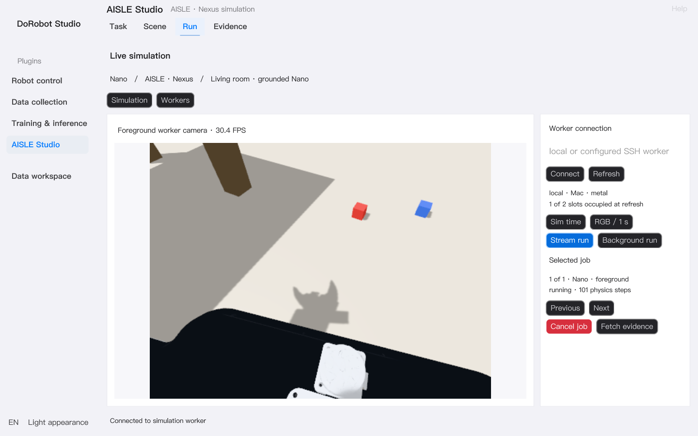

# Live camera rate on the Run page

Start a local simulation on **Run**, or choose **Workers → Stream run** to watch a worker. The frame rate beside the camera counts distinct RGB exposures drawn by Makepad. The job inspector separately shows physics steps. A background snapshot has its own label.

The display uses draw intervals from the preceding two seconds, measured at the most recent draw. It needs at least half a second of observations to show a number. A two-second interruption switches the label to **Stream stalled**. Fresh frames restart the measurement. Changing the camera source clears its previous measurements. After the run, the last image remains available for inspection.



## Native checks

| Foreground | Sample from visible camera heading | Task and recovery |
| --- | ---: | --- |
| M3 Max, 1440 × 900 offscreen, Codex-authored Nano | 30.6 FPS | The red cube reached the table. Studio switched to the background job’s snapshot, then recovered the original 342-frame foreground episode after restart. |
| One H100 NVL, 1024 × 768 headless Studio, DeepSeek controller authored through Octos | 17.7 FPS | The red cube reached the table. Both the evidence and the 347-frame export reopened after restart. |

These readings are short samples of the on-screen counter. Immediately before interrupting the H100 camera receiver, Studio drew 35 intervals over 1.982 seconds. The operator saw **Stream stalled** after 2.094 seconds of the interruption, then **Waiting for frames**, then a new FPS value. The original simulation kept running on the same worker lease throughout. [Native draw timestamps](native-draws.json) · [Label sequence during interruption](worker-stall.json)

The direct local path also ran the floating-base G1 standing reach with its development impact fixture and draw tracing disabled. Its external operator camera showed about 6 FPS during the trial and returned to its static heading on completion. Both feet stayed loaded for 2,000 steps. The episode contains 101 frames and reopened after restart. [G1 camera labels, impact and recovery](g1-local.json)

## Renderer measurements

On one H100 NVL we replayed the same 320 motor commands with no policy decisions, using layout 0 of the Nano living room. After 64 warm-up steps we timed 256 sequential steps with one head exposure per step. At eight equally spaced ticks we retained all three RGB images and the robot configuration. Each configuration below ran once in a fresh engine. The original settings also ran a second time. The complete production transfer additionally captures wrist exposures for decisions and recordings, publishes previews, and sends them to Studio. The timings below measure the worker portion of the short replay.

| Nexus and shadow settings | Mean measured step | Median head render and readback | Pixels changed across 24 images | Configuration readings identical |
| --- | ---: | ---: | ---: | --- |
| 0.2.1, original 4096 | 47.07 ms | 32.17 ms | Reference | Reference |
| 0.2.1, original 4096 repeated | 46.54 ms | 32.25 ms | 0 | Yes |
| 0.2.1, omit floor from shadow casters | 40.64 ms | 26.55 ms | 221 (0.00533%) | Yes |
| 0.2.1, 2048 shadows | 36.46 ms | 22.81 ms | 99,265 (2.39354%) | Yes |
| 0.2.1, 1024 shadows | 34.18 ms | 20.52 ms | 177,082 (4.26992%) | Yes |
| 0.3.0, original 4096 | 46.44 ms | 32.04 ms | 256,389 (6.18222%) | No |

The denominator is 4,147,200 RGB pixels. A pixel counts as changed if any color channel differs. Even the floor-only change affected all 24 sampled images. The isolated 0.3.0 wheel changed the trajectory with the same motor commands. Studio continues to use the qualified 0.2.1 configuration. The measured production H100 viewport remains below the 25 FPS goal. [Full eight-H100 and Mac capacity measurements](../eight-h100/lossless-rgb/README.md)

Run the following from this directory in a Python environment with NumPy. The audit verifies the motor journal against the published full transfer and recalculates comparisons from the original pixels, configuration samples and per-tick nanosecond records.

```sh
python audit.py --check
```

[Raw samples](render-samples.zip) · [Machine-readable comparisons](render-comparison.json) · [Measurement program and arguments](render_probe.py)
