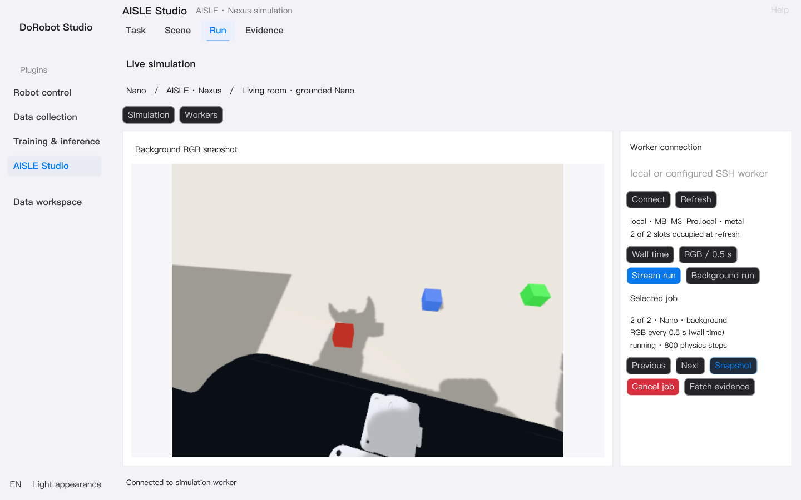

# Choosing a clock for background RGB

In **AISLE Studio → Run → Workers**, connect to the worker. Select **Wall time** to request an image at a regular interval on the worker, or **Sim time** to space observations by physics time. Select **RGB** to cycle through the available periods. Both clocks offer 1, 2 and 5 seconds. Wall time also offers 0.5 seconds.

Select **Background run**, then **Snapshot** to see its latest head-camera exposure. The selected job shows the clock and period used when it was submitted. **Cancel job** stops that lease. **Fetch evidence** imports its records. The foreground stream can continue throughout. Studio restores the selected lease and its settings after restart. Older workers advertise their compatible periods when Studio connects. [Worker setup](../worker-leases/README.md)

## Measured Mac capacity

One Apple M3 Max with 128 GiB unified memory and macOS 26.5 ran the Studio viewport and all the Nexus processes. Every session made its own call to the named provider before the controller executed. Each Nano used its onboard RGB and encoders to place the red floor cube on the coffee table on one fixed layout. The shared interval begins when every background is advancing and ends when the first stops reporting progress. The gate requires at least 30 seconds of overlap, 25 distinct native viewport draws per second and at least 1 delivered image per second for **every** observer. Rates use unrounded timestamps. [Preregistered workloads and follow-up](protocol.md)

| Sessions | Author | Requested period | Common time | Foreground FPS | Observer delivery | Seconds below 25 FPS | Gate |
| ---: | --- | ---: | ---: | ---: | ---: | ---: | --- |
| 8 | DeepSeek + Octos | 1 s | 75.6 s | 28.62 | 0.9981–1.0040 Hz | 1/75 | Miss |
| 8 | Codex | 1 s | 76.2 s | 28.62 | 0.9990–1.0042 Hz | 0/76 | Miss |
| 8 | DeepSeek + Octos | 0.5 s | 77.2 s | 28.62 | 2.0001–2.0097 Hz | 1/77 | Pass |
| 8 | Codex | 0.5 s | 76.8 s | 28.68 | 1.9994–2.0063 Hz | 1/76 | Pass |
| 10 | DeepSeek + Octos | 0.5 s | 93.1 s | 27.88 | 1.9898–2.0054 Hz | 2/93 | Pass |
| 10 | Codex | 0.5 s | 92.0 s | 28.24 | 1.9929–2.0074 Hz | 0/92 | Pass |
| 12 | DeepSeek + Octos | 0.5 s | 108.1 s | 25.02 | 1.9863–2.0021 Hz | 45/108 | Pass |
| 12 | Codex | 0.5 s | 108.4 s | 24.80 | 1.9984–2.0066 Hz | 54/108 | Miss |
| 16 | DeepSeek + Octos | 0.5 s | 145.5 s | 18.12 | 1.9836–2.0038 Hz | 145/145 | Miss |

**Ten simultaneous sessions** passed with both providers, the largest tested load to do so. At 12 the DeepSeek run averaged 25.02 FPS and spent 45 of 108 complete seconds below 25 FPS. The Codex run averaged 24.80 FPS and missed the gate. At 16 the viewport averaged 18.12 FPS. All 92 Nano transfers passed on this fixed layout, with continuous measured wheel support and identical motor journals. The trials measure execution throughput. Nano performance on new layouts has a separate [three-cube qualification](../nano-qualification.md).

The foreground counts fresh 480 × 360 head-camera exposure ticks drawn by Makepad. Worker publication timestamps and client receipts describe how often images became available and how often the observer actually received them. The local measurements use the same host's monotonic clock. A delayed process advances its next deadline to the future and resumes with a fresh exposure. The ordinary control and recording clocks continue independently. The complete foreground export retains synchronized head, left-wrist and right-wrist images, encoders and actions.

For the one-simulated-second setting, the original Mac benchmark passed with six sessions and missed at seven. With eight it measured 28.39 foreground FPS and 0.84–0.88 Hz at the observers. On the eight-H100 configuration, a Mac viewport receiving the remote stream drew 16.21–16.40 FPS under that original setting. All eight Linux workers advertised the new wall clock and 0.5-second period in a fresh SSH preflight. The scheduler reported the node down and existing processes used 96–99% of each GPU at the recorded sample. On the Mac, the configurable remote-cohort observer also completed a local Metal run with 216 verified RGB receipts and 12,608 consecutive supported physics ticks. A new eight-GPU throughput measurement is still open. [Worker capabilities and host occupancy](h100-preflight.json) [Earlier Mac measurements](../foreground-preview/README.md) · [Remote measurements and runner](../eight-h100/README.md)

## Native controls and G1 balance

Seven successful two-job Nano journeys exercised the Run page, RGB snapshot, independent cancellation, evidence import and restart. Offscreen Makepad used DeepSeek through Octos at 1440 × 900. Headless Makepad used Codex at 1024 × 768. Each backend exercised both the 1-second and 0.5-second wall settings. An intermediate layout passed the desktop journey. Its compact run put Cancel job below the reachable area at 1024 × 768 and the test timed out waiting for cancellation. The final layout places Snapshot beside Previous and Next and keeps Cancel job on the following row. The audit matches the selected RGB snapshot digest to its archived physics tick and checks the restored foreground export. [Compact regression coordinates](compact-cancel-regression.json)

For G1, seven trials repeated the same floating-base standing reach under a bounded impact. Each kept both feet loaded for all 2,000 steps, respected the measured joint limits and kept settled wrist error below 5 mm. A 1-second simulation period produced 11 images at 0.584–0.591 Hz. The 1-second wall interval produced 17 at 1.001–1.002 Hz. The 0.5-second wall interval produced 35 at 2.003 Hz. In the four fixed-environment repeats, the largest per-joint target difference was 4.97 microradians across clocks and 4.97 microradians between same-clock repeats. The archive includes the motor and measured wrist traces. [G1 task qualification](../g1-thirty-degree-reach/README.md)

## Reproduce the checks

Use the Studio Python environment and built native instrument. The capacity run uses the native Run controls to select the clock and period and collects the client receipts while the simulators advance. Use a fresh output directory per run.

~~~sh
"$DOROBOT_AISLE_PYTHON" tools/aisle_workbench/verify.py \
  --studio "$studio_binary" --remote "$makepad_remote" \
  --backend offscreen --size 1440x900 --fleet --foreground-cadence 8 \
  --background-clock wall --background-period-s 0.5 \
  --octos-deepseek --out "$fresh_run"
~~~

Use `--codex` for the other author. To exercise the snapshot and cancel controls with two jobs, omit `--foreground-cadence 8`. Use `--backend headless --size 1024x768` for the compact functional check. The legacy clock can be selected with `--background-clock simulation --background-period-s 1`.

To reproduce the [measured values](measurements.json) from the [original observations, motor journals and dataset](measurements.zip), run the following command from the Studio checkout. The dataset option uses PyArrow and FFprobe to verify timestamps, frame counts and the 17 recorded action and encoder values. The G1 trace checks use NumPy.

~~~sh
guide=docs/product/aisle-studio/validation/wall-clock-rgb
"$DOROBOT_AISLE_PYTHON" "$guide/audit.py" "$guide/measurements.zip" --datasets
~~~
